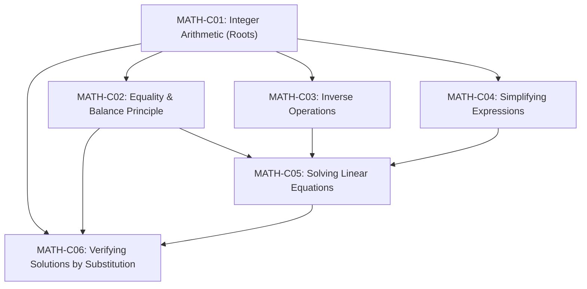

# SUTRA LEARN (Student Understanding, Targeted Reinforcement & Adaptation)
### Version 1.0.0 Release Candidate — Earthbound Editorial Edition
[](docs/testing-guide.md)
[](docs/testing-guide.md)
[](screenshots/)
[](frontend/)
[](docs/architecture-current.md)

> **Core Pedagogical Principle**: *A wrong answer is a signal to investigate, not a label to assign.*

SUTRA LEARN is an evidence-informed adaptive mathematics ecosystem designed for **NCERT Class 8 Mathematics (Linear Equations and Prerequisite Progression)**. It features an unbreachable dual-portal architecture separating the **Student Space** from the **Educator Workspace**, powered by deterministic Bayesian Knowledge Tracing (BKT) and curriculum-grounded SUTRA AI intelligence.

---

## 1. Distinctive Product Architecture

```
                               ┌────────────────────────────────┐
                               │       PORTAL GATEWAY (/)       │
                               │  - Earthbound Editorial Brand  │
                               │  - Unbreachable Dual Gateways  │
                               └───────┬────────────────┬───────┘
                                       │                │
                      Student Gateway  │                │  Educator Gateway
                                       ▼                ▼
                     ┌───────────────────┐    ┌───────────────────┐
                     │  /student/login   │    │  /teacher/login   │
                     │  Learner Auth     │    │  Faculty Auth     │
                     └─────────┬─────────┘    └─────────┬─────────┘
                               │                        │
                    Token: role='student'    Token: role='teacher'
                               ▼                        ▼
                 ┌───────────────────────────┐ ┌───────────────────────────┐
                 │      SUTRA / STUDENT      │ │     SUTRA / EDUCATOR      │
                 │   (Top Bar Shell: 70px)   │ │  (Left Rail Sidebar: 256px)│
                 ├───────────────────────────┤ ├───────────────────────────┤
                 │ • /student/home           │ │ • /teacher/dashboard      │
                 │ • /student/pathway        │ │ • /teacher/learners       │
                 │ • /student/progress       │ │ • /teacher/learners/:id   │
                 │ • /student/tutor (AI)     │ │ • /teacher/insights       │
                 │ • /student/lesson/:id     │ │ • /teacher/interventions  │
                 │ • /student/assessment/:id │ │ • /teacher/assistant (AI) │
                 │ • Sign Out -> /           │ │ • /teacher/audit          │
                 │                           │ │ • Sign Out -> /           │
                 └───────────────────────────┘ └───────────────────────────┘
```

- **Zero Post-Login Role Switching**: Once authenticated, the student portal and educator workspace contain zero role dropdowns or portal jumpers.
- **Strict Identity Trust Boundary**: Client headers `x-user-id` and `x-teacher-id` are ignored. All endpoints require cryptographic HMAC-SHA256 bearer tokens.
- **Deterministic Adaptive Scorer**: Bayesian Knowledge Tracing (BKT) computes all mastery updates. AI models never modify student mastery.

---

## 2. Key Intelligence Systems

### 2.1 SUTRA AI Personal Mathematics Tutor (`/student/tutor`)
- **Socratic First**: Guided dialogue that leads students to discover algebraic principles rather than handing out answers.
- **6 Teaching Modes**: Guided Learning, Concept Explanation, Worked Examples, Diagnostic Practice, Check My Work, and Prerequisite Support.
- **Progressive Hinting**: 3 tiers of scaffolded assistance (conceptual nudge $\to$ structural advice $\to$ worked derivation).
- **Curriculum-Grounded Fallback**: Operates with 100% reliability offline or without external API keys using deterministic NCERT Class 8 curriculum content.

### 2.2 SUTRA AI Educator Intelligence (`/teacher/assistant`)
- **4-Level Evidence Hierarchy**: Clearly distinguishes Verified Database Facts, Calculated Statistics, Qualitative AI Interpretations, and Recommended Actions.
- **Human-in-the-Loop Interventions**: Proposed instructional overrides require explicit faculty confirmation and a substantive clinical rationale ($\ge 5$ characters).
- **Tamper-Evident Audit Logging**: Every override is cryptographically hashed with SHA-256 state signatures.

---

## 3. NCERT Class 8 Mathematics Curriculum Graph



---

## 4. Quick Start & Execution

### Prerequisites
- Python 3.11+
- Node.js 18+ and npm

### 1. Start Backend API
```powershell
cd backend
.\.venv\Scripts\Activate.ps1
uvicorn app.main:app --host 127.0.0.1 --port 8000 --reload
```
- Health Check: `http://127.0.0.1:8000/api/v1/health`
- Interactive OpenAPI Docs: `http://127.0.0.1:8000/docs`

### 2. Start Frontend SPA
```powershell
cd frontend
npm install
npm run dev
```
Open browser at `http://127.0.0.1:5173`.

---

## 5. Verification & Test Execution

### Backend Pytest Suite (35/35 Passing in 1.76s)
```powershell
pytest backend/tests -v
```

### Hermetic E2E Verification (14/14 Stages Passing, Exit Code 0)
```powershell
python scripts/verify_e2e.py
```

### Visual Cross-Device Screenshot Capture (48/48 Verified)
```powershell
python scripts/capture_screenshots.py
```
Captures 16 distinct application screens across Desktop ($1440\times960$), Tablet ($1024\times768$), and Mobile ($390\times844$) into `screenshots/`.

### Frontend Oxlint & Vite Build
```powershell
npm --prefix frontend run lint     # Oxlint: 0 errors, 0 warnings
npm --prefix frontend run build    # tsc -b && vite build: clean production bundle
```

---

## 6. Seed Personas & Demo Accounts

| Persona | Role | ID / Username | Password | Learning / Faculty Context |
| :--- | :--- | :--- | :--- | :--- |
| **Aarav Sharma** | Student | `student-01` | `sutra123` | First-time learner starting Integer Arithmetic |
| **Diya Patel** | Student | `student-02` | `sutra123` | Demonstrates prerequisite gaps in algebraic sign rules |
| **Kabir Sen** | Student | `student-03` | `sutra123` | High-performing learner ready for two-step equations |
| **Ms. Ananya Roy** | Teacher | `teacher-01` | `teacher123` | Mathematics Department Head with cohort oversight |

---

## 7. Comprehensive Documentation Index

- [Current Architecture Analysis](docs/architecture-current.md)
- [Target Production Architecture](docs/architecture-target.md)
- [Engineering Findings & Root-Cause Remediation](docs/engineering-findings.md)
- [Application Security & Threat Model Review](docs/security-review.md)
- [SUTRA AI Personal Mathematics Tutor Architecture](docs/ai-tutor-architecture.md)
- [SUTRA AI Educator Intelligence Architecture](docs/educator-intelligence.md)
- [Database Schema & Query Performance Guide](docs/database-design.md)
- [Automated Testing & QA Verification Guide](docs/testing-guide.md)
- [Cloud Deployment & Operations Guide](docs/deployment-guide.md)
- [Engineering Execution Log](docs/engineering-execution-log.md)
