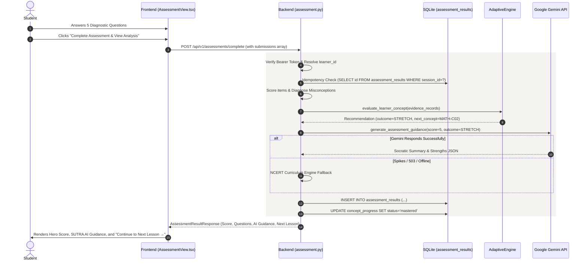

# SUTRA LEARN — DATABASE ARCHITECTURE & DATA FLOW SPECIFICATION
**Version:** 1.0.0 (Production Release)  
**Database Engine:** SQLite 3 (WAL Mode, PRAGMA foreign_keys = ON)  
**ORM / Data Access:** Python standard `sqlite3` with `Row` factory & Parameterized Queries  

---

## 1. Relational Database Schema (DDL)

```sql
-- 1. Learner & User Accounts
CREATE TABLE IF NOT EXISTS learners (
    id TEXT PRIMARY KEY,
    name TEXT NOT NULL,
    grade INTEGER NOT NULL DEFAULT 8,
    role TEXT NOT NULL DEFAULT 'student', -- 'student' | 'teacher'
    password_hash TEXT,
    created_at TIMESTAMP DEFAULT CURRENT_TIMESTAMP
);

-- 2. Assessment Sessions
CREATE TABLE IF NOT EXISTS assessment_sessions (
    id TEXT PRIMARY KEY,
    learner_id TEXT NOT NULL,
    concept_id TEXT NOT NULL,
    status TEXT NOT NULL DEFAULT 'active', -- 'active' | 'completed'
    started_at TIMESTAMP DEFAULT CURRENT_TIMESTAMP,
    completed_at TIMESTAMP,
    FOREIGN KEY (learner_id) REFERENCES learners(id) ON DELETE CASCADE
);

-- 3. Completed Assessment Results & AI Guidance (New in Omega Rapid Stabilization)
CREATE TABLE IF NOT EXISTS assessment_results (
    id TEXT PRIMARY KEY,
    session_id TEXT,
    learner_id TEXT NOT NULL,
    concept_id TEXT NOT NULL,
    score INTEGER NOT NULL,
    total_questions INTEGER NOT NULL,
    percentage REAL NOT NULL,
    passed INTEGER NOT NULL DEFAULT 1,
    outcome TEXT NOT NULL, -- 'STRETCH' | 'CONFIRM' | 'SCAFFOLD' | 'BRIDGE_BACK' | 'TEACHER_REVIEW'
    next_concept_id TEXT,
    next_concept_title TEXT,
    can_advance INTEGER NOT NULL DEFAULT 1,
    questions_detail_json TEXT NOT NULL,
    misconceptions_json TEXT,
    ai_guidance_json TEXT,
    created_at TIMESTAMP DEFAULT CURRENT_TIMESTAMP,
    FOREIGN KEY (learner_id) REFERENCES learners(id) ON DELETE CASCADE,
    FOREIGN KEY (session_id) REFERENCES assessment_sessions(id) ON DELETE SET NULL
);
CREATE INDEX IF NOT EXISTS idx_assessment_results_learner_concept 
ON assessment_results(learner_id, concept_id, created_at);

-- 4. Question Attempts (Idempotent per client attempt_id)
CREATE TABLE IF NOT EXISTS attempts (
    id TEXT PRIMARY KEY, -- Client-generated UUID for idempotency
    session_id TEXT,
    learner_id TEXT NOT NULL,
    question_id TEXT NOT NULL,
    concept_id TEXT NOT NULL,
    selected_option_id TEXT NOT NULL,
    is_correct INTEGER NOT NULL, -- 0 or 1
    hint_used INTEGER NOT NULL DEFAULT 0, -- 0 or 1
    misconception_tag TEXT DEFAULT 'none',
    cognitive_demand TEXT DEFAULT 'procedural',
    client_timestamp TIMESTAMP,
    server_timestamp TIMESTAMP DEFAULT CURRENT_TIMESTAMP,
    sync_status TEXT DEFAULT 'synced',
    FOREIGN KEY (learner_id) REFERENCES learners(id) ON DELETE CASCADE,
    FOREIGN KEY (session_id) REFERENCES assessment_sessions(id) ON DELETE SET NULL
);
CREATE INDEX IF NOT EXISTS idx_attempts_learner ON attempts(learner_id, concept_id);

-- 5. Concept Progress & Mastery Tracking
CREATE TABLE IF NOT EXISTS concept_progress (
    learner_id TEXT NOT NULL,
    concept_id TEXT NOT NULL,
    status TEXT NOT NULL DEFAULT 'not_started', -- 'not_started' | 'in_progress' | 'needs_reinforcement' | 'mastered'
    unassisted_correct INTEGER DEFAULT 0,
    assisted_correct INTEGER DEFAULT 0,
    total_attempts INTEGER DEFAULT 0,
    mastery_percentage REAL DEFAULT 0.0,
    last_recommended_outcome TEXT,
    updated_at TIMESTAMP DEFAULT CURRENT_TIMESTAMP,
    PRIMARY KEY (learner_id, concept_id),
    FOREIGN KEY (learner_id) REFERENCES learners(id) ON DELETE CASCADE
);

-- 6. Teacher Clinical Overrides
CREATE TABLE IF NOT EXISTS teacher_overrides (
    id TEXT PRIMARY KEY,
    learner_id TEXT NOT NULL,
    concept_id TEXT NOT NULL,
    previous_outcome TEXT NOT NULL,
    overridden_outcome TEXT NOT NULL,
    reason TEXT NOT NULL,
    teacher_id TEXT NOT NULL,
    created_at TIMESTAMP DEFAULT CURRENT_TIMESTAMP,
    FOREIGN KEY (learner_id) REFERENCES learners(id) ON DELETE CASCADE,
    FOREIGN KEY (teacher_id) REFERENCES learners(id)
);

-- 7. Categorized System Audit Logs
CREATE TABLE IF NOT EXISTS system_audit_logs (
    id TEXT PRIMARY KEY,
    event_category TEXT NOT NULL, -- 'PEDAGOGICAL_INTERVENTIONS' | 'REJECTED_SECURITY_EVENTS' | 'SUCCESSFUL_AUTHORIZED_ACTIONS' | 'SYSTEM_EVENTS'
    actor_id TEXT NOT NULL,
    actor_role TEXT,
    learner_id TEXT,
    concept_id TEXT,
    previous_state TEXT,
    new_state TEXT,
    rationale TEXT,
    outcome TEXT NOT NULL, -- 'APPLIED' | 'REJECTED' | 'RECORDED'
    details TEXT,
    correlation_id TEXT,
    created_at TIMESTAMP DEFAULT CURRENT_TIMESTAMP
);
CREATE INDEX IF NOT EXISTS idx_audit_category ON system_audit_logs(event_category, created_at);
CREATE INDEX IF NOT EXISTS idx_audit_correlation ON system_audit_logs(correlation_id);

-- 8. AI Tutor Conversations & Messages
CREATE TABLE IF NOT EXISTS ai_conversations (
    id TEXT PRIMARY KEY,
    owner_id TEXT NOT NULL,
    owner_role TEXT NOT NULL, -- 'student' | 'teacher'
    conversation_type TEXT NOT NULL DEFAULT 'tutor', -- 'tutor' | 'educator_assistant'
    title TEXT NOT NULL,
    concept_id TEXT,
    created_at TIMESTAMP DEFAULT CURRENT_TIMESTAMP,
    updated_at TIMESTAMP DEFAULT CURRENT_TIMESTAMP,
    FOREIGN KEY (owner_id) REFERENCES learners(id) ON DELETE CASCADE
);
CREATE INDEX IF NOT EXISTS idx_ai_conversations_owner ON ai_conversations(owner_id, conversation_type);

CREATE TABLE IF NOT EXISTS ai_messages (
    id TEXT PRIMARY KEY,
    conversation_id TEXT NOT NULL,
    sender_role TEXT NOT NULL, -- 'user' | 'assistant' | 'system'
    content TEXT NOT NULL,
    response_type TEXT DEFAULT 'standard',
    hints_json TEXT,
    concept_id TEXT,
    requires_follow_up INTEGER DEFAULT 0,
    provider_metadata TEXT,
    created_at TIMESTAMP DEFAULT CURRENT_TIMESTAMP,
    FOREIGN KEY (conversation_id) REFERENCES ai_conversations(id) ON DELETE CASCADE
);
CREATE INDEX IF NOT EXISTS idx_ai_messages_conv ON ai_messages(conversation_id, created_at);

-- 9. Spaced Retrieval Scheduling (SM-2 Algorithm)
CREATE TABLE IF NOT EXISTS spaced_retrieval_records (
    learner_id TEXT NOT NULL,
    concept_id TEXT NOT NULL,
    stability_days REAL NOT NULL DEFAULT 1.5,
    ease_factor REAL NOT NULL DEFAULT 2.5,
    repetitions INTEGER NOT NULL DEFAULT 0,
    last_practiced_at TIMESTAMP DEFAULT CURRENT_TIMESTAMP,
    estimated_retention REAL NOT NULL DEFAULT 1.0,
    next_review_due TIMESTAMP DEFAULT CURRENT_TIMESTAMP,
    retrieval_status TEXT NOT NULL DEFAULT 'CONSOLIDATED',
    updated_at TIMESTAMP DEFAULT CURRENT_TIMESTAMP,
    PRIMARY KEY (learner_id, concept_id),
    FOREIGN KEY (learner_id) REFERENCES learners(id) ON DELETE CASCADE
);
CREATE INDEX IF NOT EXISTS idx_spaced_retrieval_due ON spaced_retrieval_records(learner_id, next_review_due);
```

---

## 2. End-to-End Data Flow



---

## 3. Hosting & Storage Considerations

- **Local Development / Docker:** SQLite database `backend/sutra_learn.db` persists locally on disk.
- **Render Production (Free Tier):** Render web services utilize containerized root disks. In free tier configurations without a persistent disk mount, application state resets upon instance rebuilds or service redeployments.
- **Production Durability Recommendation:**
  1. Attach a Render Persistent Disk mounted at `/var/data/sutra_learn.db` with `SUTRA_DB_PATH=/var/data/sutra_learn.db`.
  2. Or configure a managed PostgreSQL / Turso distributed SQLite instance via environment configuration without requiring changes to application domain logic.
