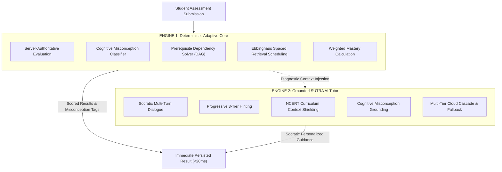

# SUTRA LEARN — Innovation & Technical Differentiation
### Why SUTRA LEARN Transcends Generic EdTech and Chatbots

This document details the concrete pedagogical and architectural innovations of **SUTRA LEARN**, articulating why its technical design outperforms both traditional Learning Management Systems (LMS) and generic generative AI wrappers.

---

## 1. The Core Innovation: Dual-Engine Pedagogical Architecture

Most modern educational software falls prey to a false dichotomy:

```
[Traditional EdTech] ◄────────────────────────────────────────► [Generative AI Wrappers]
Rigid multiple-choice quizzes                                    Generic chatbot prompts
No conceptual dialogue                                           Severe grading hallucinations
Binary right/wrong scoring                                       Spoon-feeds final answers
Zero cognitive diagnostics                                       No pedagogical curriculum alignment
```

SUTRA LEARN unites these two paradigms through a **Dual-Engine Architecture** with strict boundaries:



### Why This Separation Is Transformative
1. **Mathematical Truth is Immutable:** If an LLM grades algebraic equations, the grading is susceptible to temperature drift, token truncation, and prompt jailbreaks. In SUTRA LEARN, grading is **100% deterministic and server-authoritative**.
2. **Pedagogical Empathy is Dynamic:** While the deterministic engine ensures grading truth, Google Gemini provides human-like Socratic guidance, adapting its analogies and explanations to the diagnosed error.
3. **Decoupled Failure Modes:** If Google Gemini is slow or unavailable, the student never loses their assessment score. The score is already committed to SQLite before AI guidance is generated.

---

## 2. Technical Comparison Matrix

| Capability | Legacy EdTech (Khan Academy, Google Classroom) | Generic AI Wrappers (ChatGPT, Khanmigo clones) | SUTRA LEARN |
| :--- | :--- | :--- | :--- |
| **Grading Reliability** | High (Rigid keys) | Low (Stochastic LLM hallucination) | **100% Deterministic (Authoritative backend key)** |
| **Misconception Diagnosis** | Poor (Binary pass/fail) | Variable (Unstructured prose) | **Structured & Automated (Mapped to cognitive tags)** |
| **Explanation Methodology** | Static text / video | Direct answer spoon-feeding ($x=5$) | **Socratic Nudging (3-tier progressive hints)** |
| **Offline Functionality** | Partial / None | Zero (100% cloud dependent) | **Complete (Service Worker v2 + IndexedDB + local templates)** |
| **Educator Visibility** | Raw completion tables | None (Walled student chat) | **4-Level Evidence Hierarchy + Struggle Heatmaps** |
| **Clinical Interventions** | None | None | **Audited Clinical Overrides with mandatory rationales** |
| **Audit Traceability** | Basic web logs | Black-box prompt history | **Cryptographic Correlation IDs + SQLite WAL logs** |

---

## 3. Deep Dive: Cognitive Misconception Mapping

Rather than treating wrong answers as simple zero-points, SUTRA LEARN treats every distracter as a window into student cognition.

### Example: Question `MATH-C04-Q01`
$$\text{Solve for } x: \quad 3x - 5 = 10$$

| Option | Student Answer | Evaluator Diagnosis | Diagnosed Misconception Signature | SUTRA Socratic Intervention |
| :---: | :---: | :---: | :--- | :--- |
| **A** | $x = 5$ | **Correct** | None (Mastery demonstrated) | Confirms balance principle; proposes multi-variable challenge. |
| **B** | $x = \frac{5}{3}$ | **Incorrect** | `SIGN_TRANSPOSITION_ERROR` | Subtracted 5 instead of adding 5 to undo the $-5$. "What is the additive inverse of $-5$?" |
| **C** | $x = 15$ | **Incorrect** | `COEFFICIENT_OMISSION` | Added 5 to get $3x = 15$, but forgot to divide by the coefficient 3. "How do you undo multiplication by 3?" |
| **D** | $x = 45$ | **Incorrect** | `RECIPROCAL_INVERSION_ERROR` | Multiplied by 3 instead of dividing. "If $3 \times x = 15$, what happens when you divide both sides by 3?" |

---

## 4. Deep Dive: Educator Intelligence & The 4-Level Evidence Hierarchy

Educational AI often alienates teachers by presenting unverifiable black-box claims. SUTRA LEARN solves this with a **4-Level Evidence Hierarchy** in `/teacher/assistant`:

```
┌────────────────────────────────────────────────────────────────────────┐
│ LEVEL 1: VERIFIED DATABASE FACTS                                       │
│ • Student Aarav Sharma: 3 attempts on MATH-C01.                        │
│ • Latest Score: 1/3 (33.3%). Submissions: Q1(A), Q2(B), Q3(D).         │
├────────────────────────────────────────────────────────────────────────┤
│ LEVEL 2: CALCULATED COHORT STATISTICS                                  │
│ • Cohort average on MATH-C01: 74.2%. Aarav is 40.9% below cohort mean. │
│ • Prerequisite gap detected: Integer sign rules unmastered.           │
├────────────────────────────────────────────────────────────────────────┤
│ LEVEL 3: QUALITATIVE AI INTERPRETATIONS (Gemini)                       │
│ • "Aarav consistently struggles when subtracting negative constants,   │
│    indicating confusion between arithmetic subtraction and signed ints."│
├────────────────────────────────────────────────────────────────────────┤
│ LEVEL 4: ACTIONABLE CLINICAL RECOMMENDATIONS                           │
│ • Recommended: Bridge back to Number Line models before linear algebra.│
│ • Teacher retains final authority via audited clinical override.      │
└────────────────────────────────────────────────────────────────────────┘
```

---

## 5. What Is Genuinely Implemented vs. Future Scope

To maintain absolute academic honesty and technical integrity:

### Genuinely Implemented & Demonstrated in Production
- Dual-Portal Role-Based Access Control (`student` vs `teacher`).
- 30 NCERT Class 8 curriculum concepts and prerequisite DAG.
- 81 verified multiple-choice diagnostic questions with misconception tagging.
- Sub-20ms authoritative scoring on FastAPI backend.
- Full question review with prompt, student choice, correct answer, and explanation.
- Asynchronously decoupled Gemini guidance with multi-tier fallback.
- SQLite WAL mode ACID persistence and idempotency reconciliation.
- Ebbinghaus spaced retrieval queue scheduling.
- Teacher cohort analytics, struggle alerts, and clinical mastery overrides.
- Service Worker v2 offline app-shell caching with guaranteed valid Response objects.

### Explicitly Excluded / Future Scope
- **Automated Audio Speech Recognition:** Voice tutoring is planned for v2; current implementation is text-first.
- **Biometric or Facial Gaze Tracking:** SUTRA LEARN prioritizes learner privacy; cognitive engagement is tracked solely via answer patterns and hint latency.
- **External LMS Sync (Canvas/Blackboard LTI):** LTI 1.3 integration is scheduled for institutional enterprise pilots.

