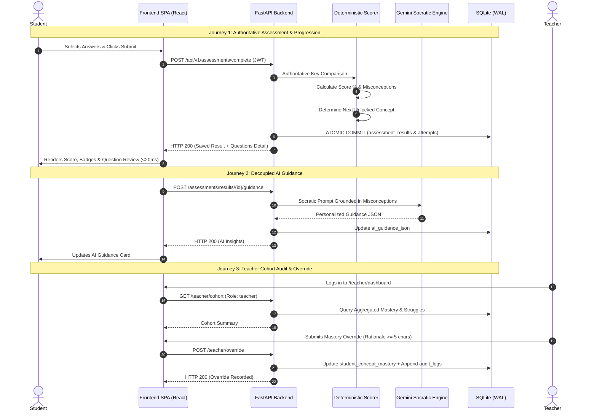

# SUTRA LEARN — Product Specification

## 1. Product Vision & Principles

### Vision Statement
To eliminate cumulative learning deficits in middle-school mathematics by replacing opaque educational algorithms with a transparent, evidence-grounded platform where cognitive misconceptions are diagnosed authoritatively and remediated Socratically.

### Core Product Principles
1. **Zero Hallucination in Grading:** Mathematical evaluation must always be server-authoritative, deterministic, and traceable to verified answer keys.
2. **Socratic Guidance Over Direct Answers:** AI must nudge, scaffold, and prompt rather than spoon-feed final calculations.
3. **Teacher Clinical Primacy:** Educational algorithms propose insights; certified educators hold final authority through audited clinical overrides.
4. **Earthbound Editorial Aesthetic:** Clean, typography-first, distraction-free interface (Ivory `#FAF7F2`, Espresso `#291C0E`, Mocha `#8C6D58`).

---

## 2. User Personas

| Persona | Role | Context & Academic Profile | Primary Jobs-to-be-Done |
| :--- | :--- | :--- | :--- |
| **Aarav Sharma** (`student-01`) | Grade 8 Student | First-time learner beginning Class 8 Chapter 2 (Linear Equations). Needs clear procedural scaffolding. | • Understand what an equation represents. • Solve equations with variable on one side. • Receive hints when stuck without giving away answers. |
| **Diya Patel** (`student-02`) | Grade 8 Student | Struggling student with hidden prerequisite gaps in negative integer arithmetic. | • Identify why answers are incorrect. • Uncover foundational integer sign misconceptions. • Bridge back to prerequisite modules before retaking tests. |
| **Kabir Sen** (`student-03`) | Grade 8 Student | High-performing student aiming for Olympiad / advanced algebra proficiency. | • Fast-track through foundational concepts. • Receive "Stretch" challenge problems. • Maintain high retention through spaced retrieval. |
| **Ms. Ananya Roy** (`teacher-01`) | Mathematics Department Head | Oversees an 8th-grade cohort of 40+ students. Needs actionable diagnostics, not raw numbers. | • Monitor real-time cohort struggle heatmaps. • Identify persistent cognitive patterns across students. • Apply clinical overrides when classroom context warrants it. |

---

## 3. Student Requirements

### 3.1 Functional Requirements (Implemented)
- **FR-S01 (Dual Portal Entry):** Student logs in via `/student/login` or one-click session `/auth/session`.
- **FR-S02 (Curriculum Pathway):** Student views NCERT Class 8 curriculum map displaying lock/unlock status dictated by prerequisite dependencies.
- **FR-S03 (Interactive Lesson):** Each concept provides structured core principles, step-by-step worked solutions, and common pitfalls.
- **FR-S04 (Authoritative Assessment):** Multi-item diagnostic quiz with procedural, conceptual, and application questions.
- **FR-S05 (Instant Server-Side Scoring):** Submissions graded authoritatively on backend in < 20ms without LLM involvement.
- **FR-S06 (Cognitive Misconception Review):** Complete question review displaying prompt, student selection, correct answer, and diagnosed cognitive error pattern.
- **FR-S07 (SUTRA Grounded AI Tutor):** Interactive chat with 6 pedagogical modes and 3 progressive hint tiers, powered by Google Gemini with deterministic fallback.
- **FR-S08 (Spaced Retrieval Queue):** Ebbinghaus decay curve (1, 3, 7, 14 days) prompting scheduled memory reinforcement reviews.
- **FR-S09 (Offline Attempt Queueing):** In offline conditions, attempts are cached in IndexedDB and synchronized upon reconnection.

### 3.2 Non-Functional Requirements (Implemented)
- **NFR-S01 (Zero Blank Screen / Error Shield):** Route and component errors caught via `<ErrorBoundary>` with clear recovery actions.
- **NFR-S02 (Mobile Responsiveness):** Fully responsive across Mobile ($390\text{px}$), Tablet ($1024\text{px}$), and Desktop ($1440\text{px}$).
- **NFR-S03 (Service Worker Resilience):** App shell cached in Service Worker v2, never returning `undefined` from `respondWith`.
- **NFR-S04 (Learner Data Isolation):** Students can only access their own scores and conversation records (HTTP 403 enforced on cross-learner requests).

---

## 4. Teacher Requirements

### 4.1 Functional Requirements (Implemented)
- **FR-T01 (Faculty Portal Entry):** Teacher logs in via `/teacher/login` using credentials (`teacher-01` / `teacher123`).
- **FR-T02 (Cohort Mastery Heatmap):** Dashboard displays student mastery distributions, struggle indicators, and active alert counts.
- **FR-T03 (Detailed Student Audit Timeline):** Deep-dive into individual student attempts, question responses, hints used, and timestamps.
- **FR-T04 (Clinical Mastery Overrides):** Faculty can manually adjust student mastery or force-unlock concepts.
- **FR-T05 (Mandatory Clinical Rationale):** Overrides strictly require a written clinical justification ($\ge 5$ characters).
- **FR-T06 (Immutable Audit Trail):** Every teacher override is recorded in SQLite with correlation ID, actor ID, and state diff.
- **FR-T07 (Educator AI Assistant):** Natural language analytics query engine adhering to a **4-Level Evidence Hierarchy** (Verified Database Facts $\to$ Calculated Statistics $\to$ Qualitative AI Interpretations $\to$ Recommended Interventions).

---

## 5. Main User Journeys

---

## 6. Implementation Status Matrix

### Fully Implemented & Verified Features
- [x] Dual-portal JWT authentication with role enforcement (`student` vs `teacher`).
- [x] 30 NCERT Class 8 curriculum concepts and prerequisite DAG navigation.
- [x] 81 verified curriculum diagnostic questions with misconception mappings.
- [x] Authoritative server-side grading with 0% LLM intervention.
- [x] Question-by-question review displaying prompts, LaTeX equations, options, and explanations.
- [x] Grounded SUTRA AI Tutor with 6 pedagogical modes and 3 progressive hint tiers.
- [x] Multi-tier Gemini cascade (`gemini-flash-lite-latest` $\to$ `gemini-3.1-flash-lite` $\to$ deterministic fallback).
- [x] Spaced retrieval queue calculated from attempt recency.
- [x] Teacher cohort analytics, struggle alerts, and individual learner timelines.
- [x] Audited clinical overrides with mandatory rationales and correlation IDs.
- [x] Offline Service Worker v2 shell caching and IndexedDB queueing.
- [x] AEO, GEO, and SEO metadata including JSON-LD structured schemas.

### Planned / Future Scope (Not Claimed as Current)
- [ ] Automatic audio speech recognition (STT/TTS) for voice-assisted mobile tutoring.
- [ ] Integration with school district SIS / Google Classroom rostering.
- [ ] Curriculum expansions for NCERT Class 9 and Class 10 mathematics.

