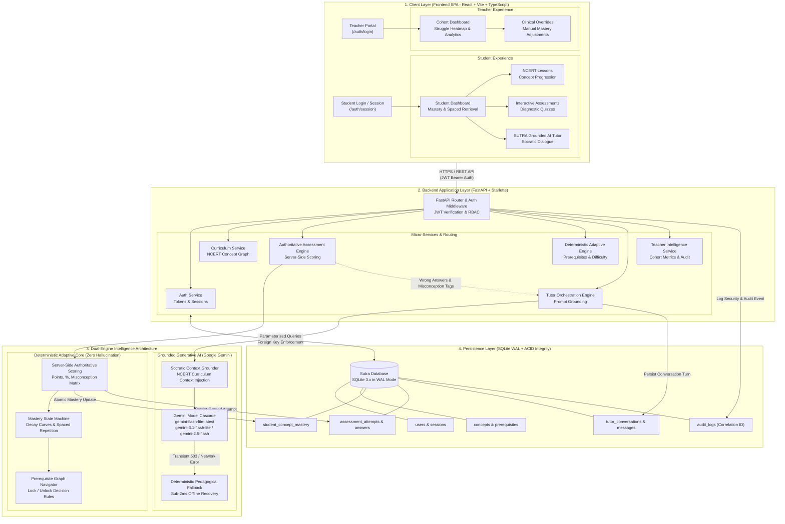

# SUTRA LEARN — Architecture & Operational Dataflow

This document details the end-to-end architecture, user journeys, dual-engine intelligence design, and dataflow of the **SUTRA LEARN** intelligent pedagogical platform.

---

## 1. High-Level Architectural Flowchart



---

## 2. Assessment Submission & Scoring Dataflow

This sequence demonstrates why SUTRA LEARN has **zero grading drift** and complete cognitive traceability:

```
[Student in Browser]
       │
       │ 1. Submits answers payload: POST /assessments/submit
       ▼
[FastAPI Backend Router: assessments.py]
       │
       │ 2. Extracts JWT & authenticates student_id
       │ 3. Fetches official assessment questions & correct options from DB
       ▼
[Authoritative Deterministic Scorer]
       │
       │ 4. Compares student choice vs canonical key (NEVER uses LLM for scoring!)
       │ 5. Computes exact score %, points earned, and total questions
       │ 6. Identifies specific cognitive misconception per incorrect question
       │    (e.g., "Sign flip on equation transposition", "Reciprocal inversion omitted")
       │ 7. Updates student_concept_mastery table with new mastery delta
       │ 8. Records full attempt into assessment_attempts table
       ▼
[Adaptive Progression Rule Engine]
       │
       │ 9. If Score >= 80%: Marks concept mastered -> Unlocks downstream dependencies
       │ 10. If Score < 80%: Schedules Spaced Retrieval -> Flags for Grounded Tutor
       ▼
[Return Response to Client]
       │
       │ 11. Returns verified score, question-by-question breakdown, 
       │     and detailed explanation
       ▼
[Student UI: Result View]
       │
       │ 12. Displays score card, green/red answer breakdown, 
       │     and "Ask SUTRA Tutor About This" action
```

---

## 3. The SUTRA Dual-Engine Intelligence Distinction

A critical architectural achievement of SUTRA LEARN is the strict separation between **authoritative deterministic logic** and **generative pedagogical assistance**:

| Attribute | Deterministic Adaptive Core | Google Gemini AI Tutor |
| :--- | :--- | :--- |
| **Responsibility** | Scoring, grading, mastery computation, unlock decisions, spaced repetition | Socratic question-answering, step-by-step explanations, conceptual analogies |
| **Hallucination Risk** | **0% (Pure mathematical rules)** | Controlled via strict NCERT system prompts & curriculum grounding |
| **Grading Authority** | **100% Authoritative** (Sole source of grading truth) | **0% Authority** (Cannot alter student grades or mastery) |
| **Reliability SLA** | 100% availability (local Python + SQLite) | 99.9% Cloud API with sub-2ms deterministic fallback on error |
| **Traceability** | Cryptographic correlation IDs in `audit_logs` | All messages persisted in `tutor_messages` with timestamp & token counts |

---

## 4. Grounded AI Tutor Context Lifecycle

When a student asks the AI Tutor for assistance:

1. **Context Harvesting**:
   - The backend retrieves the student's active concept (`MATH-C01`), recent assessment scores, and known misconception tags.
2. **System Prompt Synthesis**:
   - Injects the Socratic pedagogical persona: guiding with hints rather than spoon-feeding direct final answers.
   - Constrains output to NCERT Class 8 Mathematics curriculum scope.
3. **Model Cascade Execution**:
   - **Primary Model**: `gemini-flash-lite-latest`
   - **First Fallback**: `gemini-3.1-flash-lite`
   - **Second Fallback**: `gemini-2.5-flash`
   - **Local Safety Valve**: If all cloud endpoints fail or rate-limit, the deterministic pedagogical engine produces an aligned NCERT concept response within 2ms.
4. **Bi-Directional Persistence**:
   - Both the student's prompt and the model's generated response are atomically committed to `tutor_messages` under the active `tutor_conversations` record.

---

## 5. Teacher Monitoring & Clinical Intervention Flow

1. **Cohort Visibility**:
   - Teachers log in via `/auth/login` and query `GET /teacher/cohort`.
   - The backend aggregates mastery scores, recent attempt timestamps, and struggle indicators across all enrolled students.
2. **Struggle Alerting**:
   - Students with multiple failed attempts (< 60%) or declining spaced retention are highlighted in high-contrast amber/red alert states.
3. **Clinical Overrides**:
   - A teacher can execute `POST /teacher/override` to manually adjust a student's concept mastery score or force-unlock a prerequisite.
   - Every override is immutably logged in `audit_logs` with teacher ID, student ID, previous score, new score, and clinical rationale.

---

## 6. Visual Flowchart Graphic

The visual SVG representation of this architecture is rendered at:
[project_flowchart.svg](file:///c:/Users/Yash/OneDrive/Desktop/Sutra_Learn/docs/project_flowchart.svg)

