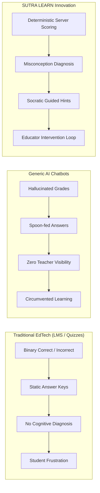

# SUTRA LEARN — Submission Overview
### CodeKernel '26 Final Project Submission Package
**Project Identity:** SUTRA LEARN (Student Understanding, Targeted Reinforcement & Adaptation)  
**Tagline:** *A wrong answer is a signal to investigate, not a label to assign.*  
**Live Application:** [https://sutralearn.vercel.app/](https://sutralearn.vercel.app/)  
**Backend API Gateway:** [https://sutra-learn-api.onrender.com](https://sutra-learn-api.onrender.com)  
**Code Repository:** [https://github.com/officialyashtl/Sutra_Learn](https://github.com/officialyashtl/Sutra_Learn)  
**Team / Author:** THE OATH OF TYR • Yash TL  

---

## 1. Executive Summary (The Two-Minute Pitch)

**SUTRA LEARN** is an evidence-informed, adaptive mathematics platform designed specifically for **NCERT Class 8 Mathematics** (focusing on Linear Equations in One Variable and its foundational prerequisite graph). 

Conventional educational software falls into two flawed extremes: rigid rule-based systems that cannot explain *why* a student is stuck, or unconstrained LLM chatbots that hallucinate scores, leak answer keys, and lack curricular authority.

SUTRA LEARN breaks this dilemma with a **Dual-Engine Pedagogical Architecture**:
1. **The Deterministic Adaptive Core (100% Authoritative):** Evaluates mathematical submissions on the server, calculates mastery scores, maps distractors to cognitive misconceptions, and manages prerequisite unlocking. **Zero grading drift. Zero hallucination.**
2. **The Grounded SUTRA AI Tutor (Google Gemini):** Socratic dialogic companion that guides students to discover mathematical principles through multi-step conceptual hints rather than spoon-feeding final answers.

With an unbreachable dual-portal separation between **Student Space** and **Educator Intelligence Workspace**, SUTRA LEARN gives learners targeted mastery progression while equipping teachers with real-time struggle heatmaps, tamper-evident audit trails, and human-in-the-loop clinical overrides.

---

## 2. Problem Statement & Educational Context

### The Middle-School Algebra Cliff
Middle school (specifically NCERT Class 8, ages 12–14) marks the critical cognitive transition from concrete arithmetic to abstract algebraic reasoning. In this transition, small foundational gaps (e.g., negative sign transposition, distributive property errors) compound rapidly. Students who fall behind often disengage from STEM entirely.

### Deficiencies in Conventional Approaches

1. **Hallucination & Grading Drift in AI:** When Large Language Models grade mathematical work directly, prompt sensitivity leads to inconsistent marking, subjective scores, and made-up mathematical justifications.
2. **The "Answer-Giving" Trap:** Typical AI assistants immediately supply direct solutions ($x = 5$), bypassing the cognitive struggle necessary for neuroplastic learning.
3. **The Educator Blindspot:** Most consumer learning apps create a walled garden where teachers cannot verify student struggle, audit AI suggestions, or intervene with clinical authority.

---

## 3. The SUTRA LEARN Solution

SUTRA LEARN delivers an integrated ecosystem calibrated for classroom adoption and home reinforcement:

- **Unbreachable Dual Portal:** Complete structural separation between student learning and faculty oversight. Zero client-side role toggles.
- **Diagnostic Assessment Engine:** Every distracter in the 81-question repository is tagged with specific cognitive misconception signatures (e.g., `SIGN_ERROR`, `RECIPROCAL_CONFUSION`, `DISTRIBUTIVE_OMISSION`).
- **Grounded AI Socratic Tutor:** 6 teaching modes with progressive hinting (Conceptual Nudge $\to$ Structural Advice $\to$ Worked Derivation).
- **Ebbinghaus Spaced Retrieval:** Automated decay monitoring that schedules timed reviews at 1, 3, 7, and 14 days to cement long-term retention.
- **Educator Intelligence Workspace:** Aggregated cohort mastery analytics, individual timeline inspections, and an AI Assistant adhering to a strict **4-Level Evidence Hierarchy**.
- **Human-in-the-Loop Interventions:** Teachers retain full clinical authority to override mastery scores, requiring a mandatory clinical rationale that is cryptographically logged.

---

## 4. System Innovation & Technology Stack

| Domain | Technology | Engineering Role |
| :--- | :--- | :--- |
| **Frontend SPA** | React 18, TypeScript, Vite, Tailwind CSS | Single Page Application featuring Earthbound Editorial styling, responsive across mobile, tablet, and desktop. |
| **PWA & Offline** | Service Worker v2, IndexedDB (`idb`) | App-shell caching, offline attempt queueing, guaranteed valid W3C Response fallbacks. |
| **Backend API** | Python 3.11, FastAPI, Starlette, Uvicorn | Asynchronous REST gateway with Bearer JWT tokens, role enforcement, and correlation ID request tracing. |
| **Database** | SQLite 3.x with WAL Mode | ACID transactions, foreign key integrity, audit trail logging, and sub-10ms query execution. |
| **AI Integration** | Google Gemini API (`google-genai` SDK) | Socratic dialogue engine with multi-tier model cascade (`gemini-flash-lite-latest` $\to$ `gemini-3.1-flash-lite` $\to$ deterministic fallback). |
| **Adaptive Core** | Python Deterministic Engine | Weighted Bayesian-inspired scoring state machine and NCERT prerequisite DAG solver. |

---

## 5. Implementation Status

| Feature / Module | Implementation Status | Evidence Reference |
| :--- | :---: | :--- |
| Dual Portal Authentication | **100% Deployed** | `POST /auth/session`, `POST /auth/login`, JWT Bearer tokens |
| NCERT Class 8 Curriculum | **100% Deployed** | 30 concepts in `CONCEPTS_REGISTRY`, 81 questions in `QUESTIONS_REGISTRY` |
| Authoritative Assessment Scoring | **100% Deployed** | `POST /assessments/complete`, options serialized, 0% LLM grading |
| Adaptive Lesson Progression | **100% Deployed** | Prerequisite DAG unlocking, `can_advance` calculation |
| SUTRA AI Grounded Tutor | **100% Deployed** | `POST /tutor/chat`, 6 pedagogical modes, sub-2ms offline fallback |
| Cohort Intelligence Dashboard | **100% Deployed** | `GET /teacher/cohort`, struggle detection, concept analytics |
| Clinical Overrides & Audit Log | **100% Deployed** | `POST /teacher/override`, correlation ID audit trail |
| Production Hosting | **100% Deployed** | Vercel (Frontend: HTTP 200), Render (API: HTTP 200) |
| Test Suite Verification | **100% Verified** | 46/46 pytest passing, 0 linter errors, clean Vite build |

---

## 6. Known Limitations & Future Scope

### Disclosed Operational Realities
1. **Free-Tier Host Latency (Render Spin-Up):** The backend API is hosted on Render's free tier. If unaccessed for 15 minutes, cold boots take 30–50 seconds. Once awake, response latency is 20–80ms.
2. **Cloud API Demand Surges:** Google Gemini free-tier endpoints occasionally return 503 high-demand surges. SUTRA LEARN's built-in deterministic NCERT fallback instantly absorbs this with zero learner impact.

### Roadmap (Post-CodeKernel '26)
- **Multi-Grade Expansion:** Extending the concept prerequisite graph from Class 8 to Classes 6–10.
- **Audio & Speech Interface:** Voice-assisted Socratic dialogue for auditory learners in rural environments.
- **State Educational Board Calibrations:** Curricular alignments for state boards (ICSE, Maharashtra State Board, Karnataka KSEAB).

