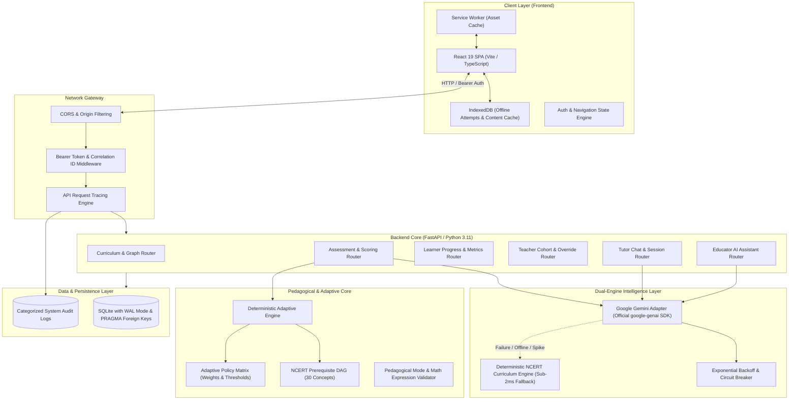

# SUTRA LEARN — SYSTEM ARCHITECTURE SPECIFICATION
**Version:** 1.0.0 (Final Omega Release)  
**Classification:** Core System Architecture & Engineering Blueprint  
**Authors:** SUTRA LEARN Engineering Organisation  

---

## 1. High-Level Architectural Overview

SUTRA LEARN (Student Understanding, Targeted Reinforcement & Adaptation) is an intelligent, deterministic, and AI-grounded adaptive learning platform engineered specifically for NCERT Class 8 Mathematics. The architecture decouples authoritative pedagogical decisions from generative AI, ensuring 100% explainability, reproducible student progress, and zero hallucinated mastery scores.

---

## 2. Component Deconstruction

### 2.1 Client Layer (`frontend/`)
- **Framework:** React 19, TypeScript ~7.0.2, Vite 8.3.5.
- **Visual Design System:** Earthbound Editorial — warm ivory backgrounds (`var(--surface-paper)`), deep espresso typography (`var(--sutra-espresso)`), muted mocha accents (`var(--sutra-mocha)`), and restrained status indicators.
- **Routing:** Lightweight hash-aware custom router (`App.tsx`) with protected student and teacher execution branches.
- **Offline Reliability:** Service Worker caching static assets; client-side IndexedDB storing queued attempts (`pending_attempts`) and cached concept trees (`cached_content`). Background reconciliation runs automatically upon network restoration.

### 2.2 API & Middleware Layer (`backend/app/main.py`)
- **Framework:** FastAPI with Uvicorn ASGI server.
- **Trace Middleware (`APITraceMiddleware`):** Injects or propagates unique `X-Correlation-ID` across every client request, timing latency down to sub-millisecond precision, decoding Bearer token claims safely, and routing 401/403/500 events into the categorized audit trail.
- **CORS Configuration:** Enforces authorized origins including `https://sutralearn.vercel.app`, `http://localhost:5173`, and preview environments.

### 2.3 Authoritative Pedagogical Engine (`backend/app/engine/`)
- **Separation of Concerns:** The adaptive engine is strictly decoupled from generative AI. LLMs do not calculate test scores, rewrite answer keys, adjust student mastery percentages, or unlock curriculum modules.
- **Deterministic Pipeline:**
  $$\text{weighted\_score} = \frac{\text{unassisted\_correct} \times 1.0 + \text{assisted\_correct} \times 0.5}{\text{total\_distinct\_questions}}$$
- **Outcome Matrix:**
  - `CONFIRM`: Insufficient evidence ($N < 3$ distinct items) or intermediate confidence ($0.60 \le \text{weighted\_score} < 0.80$).
  - `STRETCH`: Mastery demonstrated ($\text{weighted\_score} \ge 0.80$ and unassisted accuracy $\ge 0.65$). Unlocks subsequent concept.
  - `SCAFFOLD`: Conceptual confusion or low score ($\text{weighted\_score} < 0.60$). Triggers guided practice.
  - `BRIDGE_BACK`: Recurrent diagnosed misconception ($\ge 2$ errors mapped to prerequisite). Recommends prerequisite lesson.
  - `TEACHER_REVIEW`: Persistent struggle ($\ge 3$ consecutive errors with 0 unassisted correct). Halts automatic progression to prevent student frustration and flags for educator intervention.

### 2.4 Intelligence & Generative AI Layer (`backend/app/ai/`)
- **Primary Cloud Provider:** Google Gemini API using the official `google-genai` SDK (`gemini-flash-lite-latest` with cascade to `gemini-3.1-flash-lite` and `gemini-2.5-flash`).
- **Resilience Architecture:** Dual-engine cascade with circuit breaker. If Google's API returns a 503 high-demand spike, rate limit, or network error, the system seamlessly transitions to the deterministic NCERT Curriculum Engine, returning mathematically verified responses in $< 2\text{ms}$ with `is_fallback: True` clearly flagged in metadata.

### 2.5 Persistence & Database Engine (`backend/app/db/`)
- **Engine:** SQLite with Write-Ahead Logging (`PRAGMA journal_mode = WAL;`), strict foreign key enforcement (`PRAGMA foreign_keys = ON;`), and busy timeouts (`PRAGMA busy_timeout = 10000;`).
- **Data Isolation:** Every student endpoint enforces user-resource ownership by resolving the cryptographic subject (`sub`) claim from verified Bearer tokens.

---

## 3. Technology Stack Inventory

| Component | Technology | Version | Purpose |
| :--- | :--- | :--- | :--- |
| **Frontend Framework** | React | 19.3.1 | Core UI rendering and reactive state |
| **Build Tooling** | Vite | 8.3.5 | Fast development server & production bundler |
| **Type Checker** | TypeScript | 7.0.2 | Static type safety across all frontend components |
| **Frontend Linter** | oxlint | 1.89.0 | High-performance Rust-based JS/TS linter |
| **Backend Framework** | FastAPI | 0.110+ | Asynchronous REST API framework |
| **ASGI Server** | Uvicorn | 0.28+ | High-throughput asynchronous web server |
| **AI SDK** | google-genai | 0.1.1+ | Official Google GenAI SDK for Gemini API |
| **Database** | SQLite3 | 3.39+ | Zero-configuration ACID transactional database |
| **Test Automation** | pytest | 9.2.0 | Automated backend unit and integration test suite |
| **HTTP Client** | httpx | 0.27+ | Asynchronous HTTP testing and external API calls |
