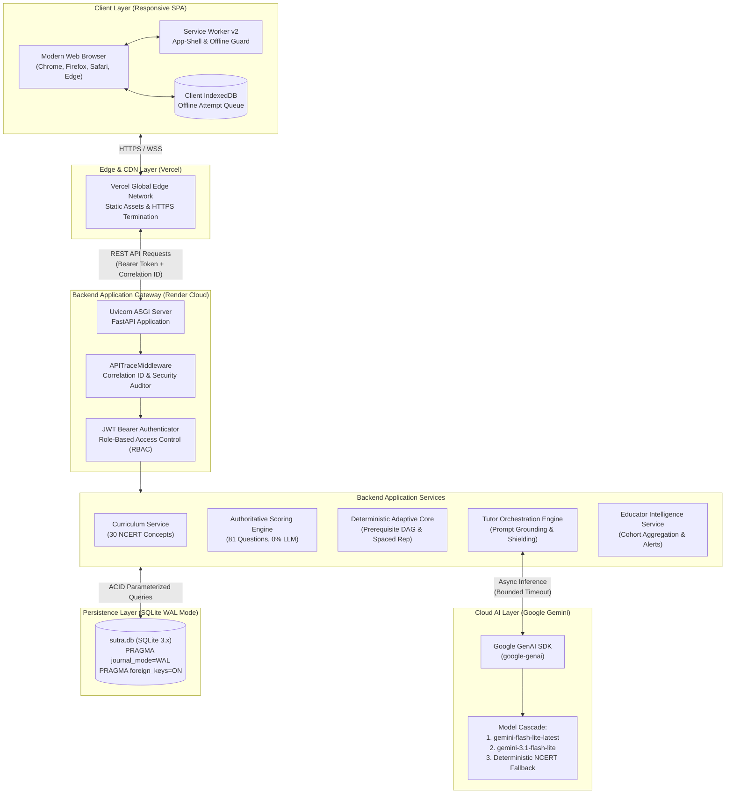
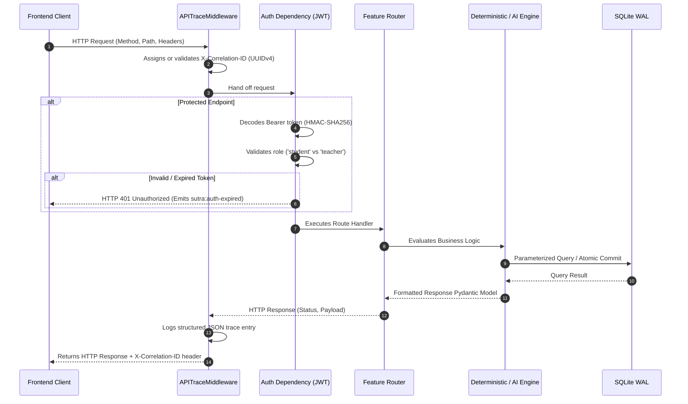
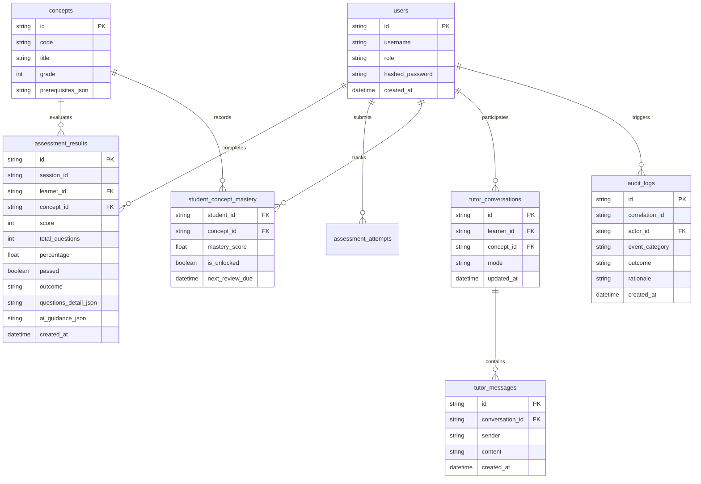

# SUTRA LEARN — Technical Architecture

This document provides a comprehensive, engineering-level breakdown of the system architecture, component topology, authentication lifecycle, deterministic scoring engine, AI integration, and persistence model powering **SUTRA LEARN**.

---

## 1. High-Level System Architecture



---

## 2. Frontend Application Topology

The client is a single-page application engineered in **React 18** with **TypeScript** and **Vite**:

```
frontend/src/
├── api/
│   └── client.ts             # Central HTTP interceptor with Bearer injection & 401 recovery
├── components/
│   ├── ErrorBoundary.tsx     # Route & component fault isolation shield
│   ├── Navbar.tsx            # Context-sensitive top-level navigation
│   ├── StudentHeader.tsx     # Student workspace shell (70px header)
│   ├── EducatorShell.tsx     # Teacher workspace shell (256px rail sidebar)
│   ├── SutraLoaders.tsx      # Earthbound Editorial pulsing state indicators
│   └── DeveloperSignature.tsx# Verified release signature
├── pages/
│   ├── LandingPage.tsx       # Public Earthbound Editorial entry
│   ├── UnifiedLogin.tsx      # Student & Teacher portal gateway
│   ├── StudentHome.tsx       # Student dashboard & active concept status
│   ├── StudentPathway.tsx    # NCERT Class 8 curriculum graph view
│   ├── LessonView.tsx        # Structured concept principles & worked steps
│   ├── AssessmentView.tsx    # Diagnostic quiz, authoritative results & review
│   ├── StudentProgress.tsx   # Mastery distribution & historical records
│   ├── StudentInsights.tsx   # Spaced retrieval queue & cognitive retention
│   ├── StudentTutor.tsx      # Socratic AI chat interface
│   ├── TeacherDashboard.tsx  # Cohort mastery & struggle alerts
│   ├── TeacherLearners.tsx   # Student roster & filterable analytics
│   ├── TeacherLearnerProfile.tsx # Individual attempt drill-downs
│   ├── TeacherInsights.tsx   # Curriculum-wide struggle analysis
│   ├── TeacherInterventions.tsx # Flagged students & clinical overrides
│   ├── TeacherAudit.tsx      # Tamper-evident immutable audit log view
│   └── EducatorAssistant.tsx # 4-Level evidence AI assistant
├── offline/
│   └── db.ts                 # IndexedDB client for offline queueing
└── public/
    ├── sw.js                 # Service Worker v2 (app-shell & zero-undefined responses)
    ├── robots.txt            # Search crawler directives (protects private portals)
    └── sitemap.xml           # Semantic sitemap
```

---

## 3. Backend Architecture & Request-Response Lifecycle

The backend runs on **FastAPI** with an asynchronous ASGI architecture. Every inbound HTTP request traverses a strict pipeline:



---

## 4. Assessment Lifecycle & Authoritative Scoring Model

To prevent **grading drift**, **score hallucination**, and **prompt gaming**, grading is strictly isolated from Large Language Models:

```mermaid
flowchart TD
    Sub["1. Student Submits Answers<br/>POST /api/v1/assessments/complete"]
    Val["2. Backend Validates Concept & Question IDs"]
    
    subgraph Deterministic_Core ["Deterministic Authoritative Scorer"]
        KeyComp["3. Exact Key Comparison against QUESTIONS_REGISTRY"]
        ScoreMath["4. Calculates Correct Count & Percentage:<br/>percentage = (correct / total) * 100"]
        Threshold["5. Passing Threshold Evaluated:<br/>passed = percentage >= 66.0%"]
        Misconception["6. Diagnoses Cognitive Misconceptions:<br/>Maps distracter choices to cognitive error tags"]
        OutcomeState["7. Evaluates Adaptive Outcome:<br/>CONFIRM | SCAFFOLD | STRETCH | BRIDGE_BACK | TEACHER_REVIEW"]
        UnlockCheck["8. Solves Prerequisite DAG:<br/>Unlocks downstream concepts if dependencies mastered"]
    end

    Persist["9. ATOMIC COMMIT to SQLite:<br/>assessment_results, assessment_attempts, student_concept_mastery"]
    ReturnResp["10. Return HTTP 200 Response to Client (<20ms)"]
    RenderUI["11. Frontend Renders Score & Question Review"]
    
    subgraph Async_Gemini ["Asynchronous Guidance (Decoupled)"]
        AsyncCall["12. Request Gemini Guidance<br/>POST /assessments/results/{id}/guidance"]
        SocraticPrompt["13. Grounded Prompt with Diagnosed Misconceptions"]
        GeminiInfer["14. Gemini Inference Cascade"]
        UpdateDB["15. Update ai_guidance_json in SQLite"]
        UpdateUI["16. Client Updates Guidance Card"]
    end

    Sub --> Val
    Val --> KeyComp
    KeyComp --> ScoreMath
    ScoreMath --> Threshold
    Threshold --> Misconception
    Misconception --> OutcomeState
    OutcomeState --> UnlockCheck
    UnlockCheck --> Persist
    Persist --> ReturnResp
    ReturnResp --> RenderUI
    RenderUI -.-> AsyncCall
    AsyncCall --> SocraticPrompt
    SocraticPrompt --> GeminiInfer
    GeminiInfer --> UpdateDB
    UpdateDB --> UpdateUI
```



---

## 5. Dual-Engine Intelligence Architecture

| Dimension | Deterministic Adaptive Core | Google Gemini AI Tutor |
| :--- | :--- | :--- |
| **Execution Environment** | Local Python runtime (`app/engine/adaptive.py`) | Google GenAI Cloud API (`google-genai` SDK) |
| **Authority** | **Sole source of grading and curriculum truth** | **Zero grading authority; pedagogical only** |
| **Response Latency** | **< 15 milliseconds** | **800 – 1,800 milliseconds** |
| **Deterministic Guarantee** | 100% reproducible mathematical outcome | Socratic, varied natural language hints |
| **Resilience Model** | Local SQLite WAL transactions | 3-tier cascade with instant deterministic fallback |

### Multi-Tier Cloud Model Cascade
1. **Tier 1 (Primary):** `gemini-flash-lite-latest` — Ultra-low latency, optimized for dialogue.
2. **Tier 2 (Surge Fallback):** `gemini-3.1-flash-lite` — High-concurrency fallback during cloud demand spikes.
3. **Tier 3 (Resilience Fallback):** `gemini-2.5-flash` — High-parameter stability model.
4. **Local Safety Valve:** Instant deterministic NCERT pedagogical template engine delivering aligned hints in under 2ms if network is offline.

---

## 6. Database Schema & Data Integrity

The persistence layer uses **SQLite 3.x** configured with:
- `PRAGMA journal_mode = WAL;` (Write-Ahead Logging for concurrent readers and writers)
- `PRAGMA foreign_keys = ON;` (Strict referential integrity)
- `PRAGMA synchronous = NORMAL;` (Optimal balance of durability and write speed)



---

## 7. Deployment & Operations Architecture

- **Frontend Hosting:** Vercel Global Edge Network with continuous deployment from `main` branch. Automated Vite builds, Gzip compression, and asset finger-printing.
- **Backend API Hosting:** Render Web Service running Python 3.11 with Uvicorn ASGI workers. Environment variables securely managed in Render Dashboard.
- **Security Posture:** Zero secrets in client bundles or Git history; CORS locked to verified origins; all mutations require Bearer authentication.

