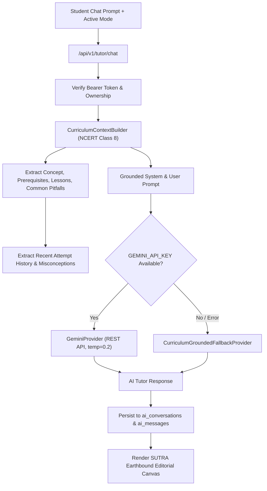

# SUTRA LEARN — SUTRA AI Personal Mathematics Tutor Architecture

## 1. Pedagogical Foundation

The **SUTRA AI Personal Mathematics Tutor** (`/student/tutor`) is designed to embody the principles of effective human tutoring:
- **Socratic Inquiry**: Never output the raw numerical answer immediately. Prompt the student to reflect on their algebraic logic.
- **Progressive Hinting**: Offer scaffolded tiers of assistance:
  - *Hint Tier 1*: Conceptual nudge (e.g., "What is the inverse operation of addition?").
  - *Hint Tier 2*: Concrete structural guidance (e.g., "Subtract 5 from both sides to keep the equation balanced.").
  - *Hint Tier 3*: Complete step-by-step worked derivation.
- **Misconception Rectification**: Detect cognitive pitfalls (such as dropping negative signs or failing to distribute terms) and offer targeted micro-interventions.
- **Zero Hallucination Guarantee**: Strict grounding against the NCERT Class 8 curriculum. The AI is structurally prohibited from altering or claiming authority over student mastery probabilities.

---

## 2. Component Architecture

---

## 3. Supported Teaching Modes

| Mode ID | Display Name | Pedagogical Purpose |
| :--- | :--- | :--- |
| `guided_learning` | Guided Learning | Step-by-step Socratic dialogue using reflective questions. |
| `explain_concept` | Concept Explanation | Intuitive conceptual breakdown with real-world analogies. |
| `worked_example` | Worked Example | Complete step-by-step solution walkthrough with balancing explanations. |
| `practice` | Practice Question | Generates an NCERT-aligned diagnostic challenge with verification. |
| `check_my_work` | Check My Work | Inspects student's handwritten or typed working to pinpoint exact error step. |
| `quick_revision` | Quick Revision | High-yield summary of formulas, properties, and definitions. |
| `prerequisite_support`| Prerequisite Support | Diagnoses and repairs gaps in Grade 6/7 foundation skills (e.g., negative integers). |

---

## 4. Multi-Tier AI Provider System

### 4.1 Primary Tier: Google Gemini REST Client (`GeminiProvider`)
- Implemented in `backend/app/ai/provider.py` using standard `urllib.request` to eliminate external dependency bloat.
- Calls Gemini 1.5 Flash (`models/gemini-1.5-flash:generateContent`).
- Injects full NCERT context, active concept properties, misconceptions to avoid, and pedagogical instructions.
- Temperature is locked to `0.2` for maximum factual consistency and mathematical precision.

### 4.2 Resilient Fallback Tier: `CurriculumGroundedFallbackProvider`
- Guarantees 100% platform availability offline or when network/API quotas are exhausted.
- Uses exact mathematical curriculum metadata defined in `backend/app/content/models.py`:
  - Mathematical definition & description.
  - Socratic guiding questions.
  - Progressive hint disclosures (Tier 1, Tier 2, Tier 3).
  - Diagnostic practice problems with validated distractor explanations.
- Appends an honest grounding disclaimer:
  > *"Response generated deterministically by SUTRA Grounded Curriculum Engine based on NCERT Class 8 Mathematics standard."*

---

## 5. Security & Session Persistence

1. **Relational Schema**:
   - `ai_conversations`: Holds `id`, `user_id`, `concept_id`, `teaching_mode`, `title`, `created_at`, `updated_at`.
   - `ai_messages`: Holds `id`, `conversation_id`, `sender_role`, `content`, `response_type`, `suggested_followups` (JSON), `created_at`.
2. **Cascade Deletes**: Deleting a conversation cleanly removes all associated messages via foreign keys.
3. **Strict Ownership**: A student can only view, post to, or delete conversations where `user_id == authenticated_student_id`.

