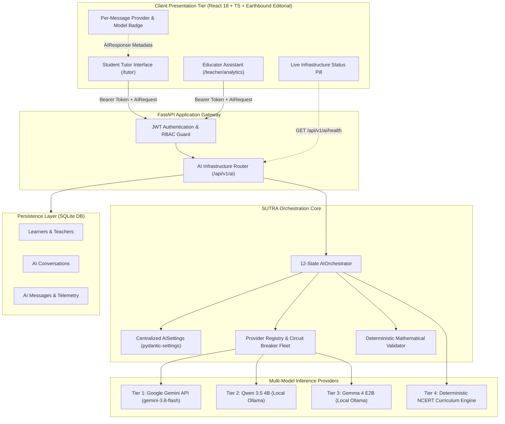

# SUTRA LEARN — AI ASCENSION 1000
## DOCUMENT 01: SYSTEM ARCHITECTURE SPECIFICATION
**Version:** 1.0.0  
**Classification:** Core Infrastructure Architectural Contract  
**System Baseline:** SUTRA LEARN Release Candidate (FastAPI + React/TS/Vite + SQLite)  
**Target Score:** 1,000 / 1,000  

---

### 1. Executive Architecture Overview

SUTRA LEARN implements a four-tiered, multi-model adaptive AI infrastructure engineered specifically for mathematics pedagogy (NCERT Class 8 Mathematics: Linear Equations in One Variable). The platform bridges remote frontier cloud inference, local edge open-weight reasoning models, and deterministic curriculum validation engines into a coherent, fault-tolerant system.

---

### 2. Tiered Inference Hierarchy & SLA Definitions

| Tier | Provider / Model | Runtime Environment | SLA Target | Failure Classification | Fallback Trigger |
| :--- | :--- | :--- | :--- | :--- | :--- |
| **Tier 1 (Cloud)** | Google Gemini API (`gemini-3.8-flash`) | Google GenAI REST Endpoint | $< 3,000$ ms | 403 Forbidden, 429 Quota, 404 Deprecated, ConnectTimeout | Immediate Circuit Trip on 403/404; Failover on 429/Timeout |
| **Tier 2 (Local)** | Qwen 3.5 4B (`qwen3.5:4b`) | Ollama Socket (`127.0.0.1:11434`) | $< 45,000$ ms (CPU) / $< 4,000$ ms (GPU) | 503 Engine Offline, Timeout, OOM, Empty Content | Failover on Socket Unreachable or Inference Timeout |
| **Tier 3 (Local)** | Gemma 4 E2B (`gemma4:e2b`) | Ollama Socket (`127.0.0.1:11434`) | $< 12,000$ ms (CPU) / $< 1,500$ ms (GPU) | 503 Engine Offline, Timeout, OOM | Failover on Socket Unreachable or Inference Timeout |
| **Tier 4 (Final)** | Deterministic Curriculum Engine | In-Memory NCERT Knowledge Base | $< 5$ ms | None (Guaranteed Deterministic Return) | Terminal Safe Fallback; $100\%$ Uptime Guarantee |

---

### 3. Key Architectural Invariants

1. **Deterministic Guarantees:** When operating in `offline` mode or during network/runtime partitioning, the system guarantees $100\%$ curriculum coverage for all 6 core linear equations concepts (`MATH-C01` through `MATH-C06`).
2. **Pedagogical Invariance:** Under no circumstances does the system provide direct, unearned homework answers to students. Every response provides scaffolded hints, Socratic questioning, or worked steps.
3. **Mathematical Step Integrity:** Outputs containing linear equation transformation chains must pass algebraic step consistency checks against the underlying root $x^*$. Contradictory steps trip internal validation and trigger fallback.
4. **Zero Secret Leakage:** Authentication keys (e.g., `GEMINI_API_KEY`) are loaded via typed environment settings, never emitted into client responses, logs, or error traces.
5. **Traceability:** Every AI interaction generates an RFC 4122 v4 Request ID (`req_...`) persisted with latency, provider, model, tokens, and validation status in SQLite.

