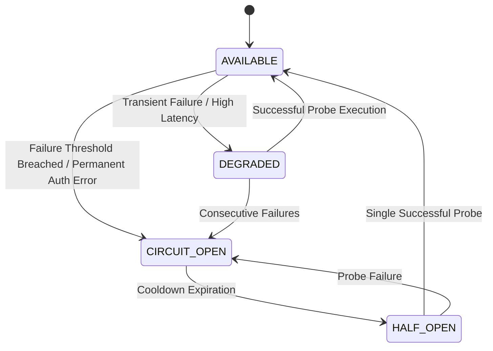

# SUTRA LEARN — AI ASCENSION 1000
## DOCUMENT 06: PROVIDER REGISTRY ARCHITECTURE
**Version:** 1.0.0  
**Implementation:** `backend/app/ai/registry.py` (`AIProviderRegistry`)  
**Design Pattern:** Centralized Service Registry with State Machine & Circuit Breakers  

---

### 1. Registry Architecture & Lifecycle

The `AIProviderRegistry` maintains the real-time operational state of all configured AI providers.



---

### 2. Legal State Transitions

The registry strictly enforces valid transitions between `ProviderState`:
- `AVAILABLE` $\rightarrow$ `DEGRADED`, `CIRCUIT_OPEN`, `UNAVAILABLE`
- `DEGRADED` $\rightarrow$ `AVAILABLE`, `CIRCUIT_OPEN`, `UNAVAILABLE`
- `CIRCUIT_OPEN` $\rightarrow$ `HALF_OPEN`, `UNAVAILABLE`
- `HALF_OPEN` $\rightarrow$ `AVAILABLE`, `CIRCUIT_OPEN`
- `UNAVAILABLE` $\rightarrow$ `AVAILABLE` (upon successful health probe)

Illegal transitions throw an explicit state violation error and are logged to audit telemetry.

---

### 3. Non-Invasive Health Probes

To prevent unnecessary API rate consumption and cost overhead, health evaluation (`evaluate_provider_health()`):
1. **Gemini:** Checks API key existence, endpoint formatting, and circuit breaker status without firing billed inference tokens.
2. **Ollama Providers (Qwen / Gemma):** Performs a non-blocking TCP socket check against `127.0.0.1:11434` followed by a local model tag inspection (`/api/tags`).
3. **Deterministic Fallback:** Evaluates curriculum repository completeness in memory ($< 1$ ms).

---

### 4. Telemetry Contract (`GET /api/v1/ai/health`)

```json
{
  "status": "healthy",
  "operating_mode": "auto",
  "offline_mode": false,
  "circuit_breakers": {
    "gemini": {
      "state": "OPEN",
      "failure_count": 1,
      "success_count": 0,
      "last_failure_reason": "403 PERMISSION_DENIED..."
    },
    "qwen": { "state": "CLOSED", "failure_count": 0, "success_count": 1 },
    "gemma": { "state": "CLOSED", "failure_count": 0, "success_count": 1 },
    "fallback": { "state": "CLOSED", "failure_count": 0, "success_count": 10 }
  },
  "providers": [
    {
      "provider_id": "gemini",
      "display_name": "Google Gemini (Cloud)",
      "model_id": "gemini-3.8-flash",
      "provider_type": "cloud",
      "state": "CIRCUIT_OPEN"
    },
    {
      "provider_id": "qwen",
      "display_name": "Qwen 3.5 4B (Local)",
      "model_id": "qwen3.5:4b",
      "provider_type": "local",
      "state": "AVAILABLE"
    },
    {
      "provider_id": "gemma",
      "display_name": "Gemma 4 E2B (Local)",
      "model_id": "gemma4:e2b",
      "provider_type": "local",
      "state": "AVAILABLE"
    },
    {
      "provider_id": "fallback",
      "display_name": "NCERT Curriculum Engine",
      "model_id": "ncert-class8-curriculum-v1",
      "provider_type": "deterministic",
      "state": "AVAILABLE"
    }
  ]
}
```

