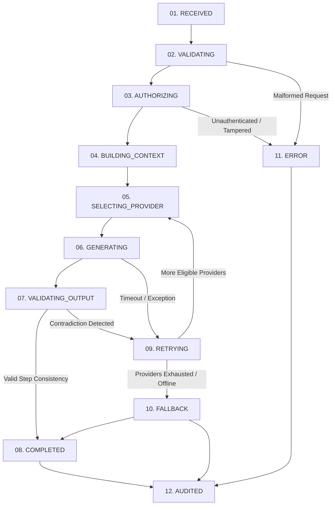

# SUTRA LEARN — AI ASCENSION 1000
## DOCUMENT 07: 12-STATE ORCHESTRATION STATE MACHINE
**Version:** 1.0.0  
**Implementation:** `backend/app/ai/orchestrator.py` (`AIOrchestrator`)  
**Specification Compliance:** SUTRA LEARN AI ASCENSION 1000 Core Directive  

---

### 1. State Machine Topology

Every student and educator request entering SUTRA LEARN traverses an explicit, deterministic 12-state lifecycle.

---

### 2. Detailed State Invariants & Behavioral Logic

| State ID | Name | Preconditions | Operational Actions | Terminal / Transition |
| :--- | :--- | :--- | :--- | :--- |
| **01** | `RECEIVED` | Raw HTTP payload enters FastAPI gateway | Assigns unique RFC 4122 v4 Request ID (`req_<hex>`), records timestamp, sets span start. | $\rightarrow$ `VALIDATING` |
| **02** | `VALIDATING` | Request ID allocated | Validates input character length ($\le 8,000$ chars), sanitizes payload, prevents injection attacks. | $\rightarrow$ `AUTHORIZING` or `ERROR` |
| **03** | `AUTHORIZING` | Valid payload syntax | Verifies JWT bearer token, checks student/teacher role boundaries, asserts conversation ownership. | $\rightarrow$ `BUILDING_CONTEXT` or `ERROR` |
| **04** | `BUILDING_CONTEXT` | Authorized session | Retrieves grounded NCERT lesson data (`MATH-C01` to `MATH-C06`), bounds conversational history to $\le 8$ turns. | $\rightarrow$ `SELECTING_PROVIDER` |
| **05** | `SELECTING_PROVIDER` | Context assembled | Queries Provider Registry for eligible models (`state == AVAILABLE` and circuit breaker `!= OPEN`). | $\rightarrow$ `GENERATING` or `FALLBACK` |
| **06** | `GENERATING` | Target provider chosen | Dispatches prompt with temperature, token limits, and bounded timeout to adapter. | $\rightarrow$ `VALIDATING_OUTPUT` or `RETRYING` |
| **07** | `VALIDATING_OUTPUT` | Raw model text received | Runs `MathematicalValidator` on linear equation transformation steps. | $\rightarrow$ `COMPLETED` or `RETRYING` |
| **08** | `COMPLETED` | Output verified | Packages structured `AIResponse` with validated pedagogical answers, hints, and metadata. | $\rightarrow$ `AUDITED` |
| **09** | `RETRYING` | Provider failed or math invalid | Records failure in circuit breaker, appends diagnostic reason, selects next tier in cascade. | $\rightarrow$ `SELECTING_PROVIDER` or `FALLBACK` |
| **10** | `FALLBACK` | Providers exhausted or offline | Invokes `CurriculumGroundedFallbackProvider` to guarantee mathematical precision and response delivery. | $\rightarrow$ `COMPLETED` |
| **11** | `ERROR` | Security or validation violation | Raises HTTP 400 / 401 / 403 / 422 with structured diagnostic payload. | $\rightarrow$ `AUDITED` |
| **12** | `AUDITED` | Response ready for dispatch | Writes message, latency, provider, tokens, and validation status to SQLite persistence. | Response dispatched to client |

