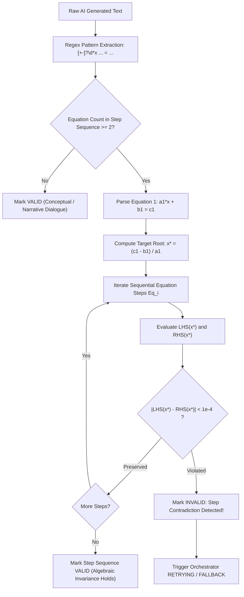

# SUTRA LEARN — AI ASCENSION 1000
## DOCUMENT 13: MATHEMATICAL OUTPUT VALIDATION SPECIFICATION
**Version:** 1.0.0  
**Implementation:** `backend/app/ai/math_validator.py` (`MathematicalValidator`)  
**Mathematical Scope:** Linear Equations in One Variable ($ax + b = c$, $ax + b = cx + d$)  

---

### 1. The Validation Imperative

Generative AI models, regardless of size, are prone to subtle sign errors, arithmetic miscalculations, and non-equivalent algebraic transformations. In an educational platform, delivering an incorrect algebraic step destroys student trust and ingrains misconceptions.

The `MathematicalValidator` inspects generated text before it reaches the student.

---

### 2. Algorithmic Verification Routine

---

### 3. Step Consistency Test Suite

Automated verification tests in `scripts/verify_mathematics.py` and `scripts/ai/verify_ai_fallback.ps1` exercise the validator against canonical equation chains:

| Equation Chain | Target Root $x^*$ | Evaluated Steps | Validation Result |
| :--- | :--- | :--- | :--- |
| `2x + 5 = 15` $\rightarrow$ `2x = 10` $\rightarrow$ `x = 5` | $x = 5$ | Step 1: $15 = 15$ Step 2: $10 = 10$ Step 3: $5 = 5$ | **`VALID`** |
| `3x - 7 = 11` $\rightarrow$ `3x = 18` $\rightarrow$ `x = 6` | $x = 6$ | Step 1: $11 = 11$ Step 2: $18 = 18$ Step 3: $6 = 6$ | **`VALID`** |
| `2x + 5 = 15` $\rightarrow$ `2x = 20` (Sign Flub) $\rightarrow$ `x = 10` | $x = 5$ | Step 1: $15 = 15$ Step 2: $2(5) = 10 \ne 20$ | **`INVALID` (Caught and Rejected)** |
| `5x + 2 = 3x + 10` $\rightarrow$ `2x = 8` $\rightarrow$ `x = 4` | $x = 4$ | Step 1: $22 = 22$ Step 2: $8 = 8$ Step 3: $4 = 4$ | **`VALID`** |

---

### 4. Zero Tolerance for Hallucinated Mathematics

If an LLM produces a step where equality is violated against the initial root, the orchestrator:
1. Rejects the generated response immediately.
2. Logs an alert: `Mathematical step validation failure: Step 2 '2x = 20' is mathematically inconsistent with root x=5.0`.
3. Cascades to the next provider or to the verified curriculum-grounded fallback.

