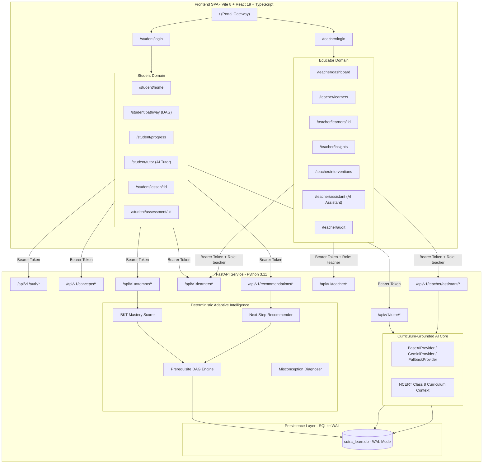

# SUTRA LEARN — Current Architecture (v1.0.0-rc1)

## 1. Executive Summary

SUTRA LEARN (**S**tudent **U**nderstanding, **T**argeted **R**einforcement & **A**daptation) is a verified adaptive mathematics learning platform designed for NCERT Class 8 curriculum. The platform features an **independent dual-portal architecture**:
1. **Student Portal** (`/student/*`): Focused, distraction-free mastery pathways, interactive Socratic lessons, diagnostic assessments with step-by-step feedback, and an integrated **SUTRA AI Personal Mathematics Tutor**.
2. **Educator Workspace** (`/teacher/*`): Diagnostic cohort analytics, individual mastery inspection profiles, human-in-the-loop instructional overrides with mandatory clinical rationales, tamper-evident audit logs, and **SUTRA AI Educator Intelligence**.

---

## 2. System Topology

---

## 3. Core Architectural Principles

### 3.1 Strict Identity Trust Boundary
- **No Header Trust**: Client-supplied headers like `x-user-id` or `x-teacher-id` are strictly forbidden for authorization.
- **HMAC-SHA256 Bearer Tokens**: All authenticated endpoints require `Authorization: Bearer sutra.<payload>.<sig>`. Tokens encapsulate `user_id`, `role`, `issued_at`, and `expires_at`.
- **RBAC Enforcement**: Educator endpoints enforce `role == "teacher"`. Student endpoints restrict access to self-owned learner records. Cross-student progress reading returns `403 Forbidden`.
- **Zero Post-Login Role Switching**: Post-login interfaces contain no persona dropdowns or portal jumpers.

### 3.2 Deterministic Adaptive Engine
The adaptive learning engine operates strictly on pedagogical evidence:
1. **Bayesian Knowledge Tracing (BKT)**:
   - Initial prior $P(L_0) = 0.15$
   - Transition probability $P(T) = 0.20$
   - Guess probability $P(G) = 0.20$
   - Slip probability $P(S) = 0.10$
   - Streak multipliers: Consecutive correct responses accelerate confidence; consecutive slips trigger prerequisite diagnostic branching.
2. **Mastery Threshold**: $P(L) \ge 0.85$ signifies demonstrated mastery.
3. **Directed Acyclic Graph (DAG)**: Strict topological sort. A concept is locked until all prerequisite parent nodes reach $P(L) \ge 0.85$.
4. **Human-in-the-Loop Overrides**: Educators can override mastery states, but only with a mandatory clinical rationale ($\ge 5$ characters). Overrides are recorded in a tamper-evident audit log with SHA-256 state hashes.

### 3.3 Curriculum-Grounded AI Architecture
- **Non-Hallucinatory Grounding**: SUTRA AI never computes or alters student mastery scores. Mastery is solely owned by the deterministic engine.
- **Two-Tier AI Provider**:
  1. *Primary*: `GeminiProvider` invoking Google Gemini REST API with strict NCERT context and zero temperature.
  2. *Resilient Fallback*: `CurriculumGroundedFallbackProvider` producing deterministic Socratic hints, worked steps, and diagnostic practice questions directly from NCERT Class 8 curriculum content in `models.py`.
- **Evidence Hierarchy for Educators**:
  1. *Verified Facts*: Raw database counts and attempts.
  2. *Calculated Statistics*: Accuracy rates, misconception frequencies.
  3. *AI Interpretation*: Qualitative synthesis clearly labeled as analytical suggestions.
  4. *Approved Interventions*: Actions requiring teacher review and confirmation.

---

## 4. Technology Stack & Runtime Specifications

| Layer | Component | Version | Role |
| :--- | :--- | :--- | :--- |
| **Frontend** | React | 19.1.0 | UI rendering & state management |
| **Frontend** | TypeScript | 5.9.3 | Strict type contracts |
| **Frontend** | Vite | 8.3.5 | Build system and bundling |
| **Frontend** | Oxlint | Latest | High-performance linter (0 errors, 0 warnings) |
| **Backend** | Python | 3.11.9 | Core server runtime |
| **Backend** | FastAPI | 0.115.11 | High-throughput asynchronous REST API |
| **Backend** | Uvicorn | 0.34.0 | ASGI web server |
| **Backend** | Pydantic | 2.10.6 | Data validation & serialization |
| **Persistence** | SQLite | 3.x | WAL-mode transactional database |
| **Testing** | Pytest | 8.3.5 | Comprehensive test suite (35 passing) |
| **E2E** | Python urllib | Custom | 14-stage automated lifecycle verification |

