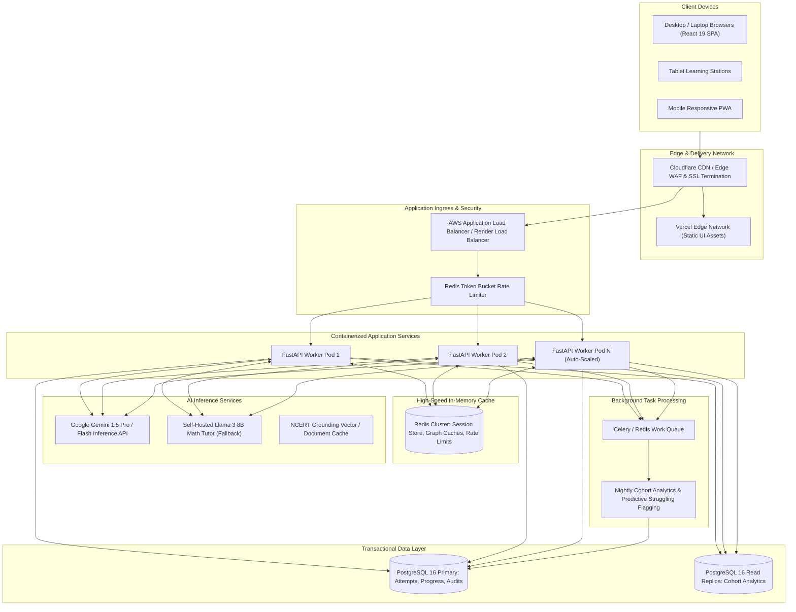

# SUTRA LEARN — Target Production Architecture

## 1. Vision & Scaling Philosophy

The target production architecture scales SUTRA LEARN from a single-school Class 8 MVP to a national-scale adaptive mathematics infrastructure supporting 100,000+ concurrent students across Grades 6–10.

Key goals:
- Sub-50ms p95 latency for assessment evaluation and next-step recommendations.
- Multi-tenant school/district isolation with strict data privacy compliant with FERPA and DPDP.
- Read-heavy caching for curriculum knowledge graphs and NCERT lesson metadata.
- Horizontal auto-scaling for FastAPI ASGI containers behind cloud load balancers.
- Transition from embedded SQLite WAL to high-availability PostgreSQL with read replicas.

---

## 2. Target Architecture Diagram

---

## 3. Component Migration Strategy

### 3.1 Database Migration: SQLite WAL -> PostgreSQL 16
| Feature | MVP (Current) | Target Production |
| :--- | :--- | :--- |
| **Engine** | SQLite 3 in WAL mode | Amazon RDS PostgreSQL 16 with Multi-AZ |
| **Concurrency** | Single-writer, multi-reader | Connection-pooled (PgBouncer) multi-writer |
| **Indexes** | B-tree composite indexes | B-tree + BRIN on audit logs + GIN for JSON tags |
| **Auditing** | SQLite SHA-256 trigger/table | PostgreSQL append-only partitioned table with cryptographic row signatures |
| **Analytics** | On-the-fly SQL aggregation | Continuous aggregated materialized views refreshed concurrently |

### 3.2 Authentication & Identity Management
- **Current**: HMAC-SHA256 stateless signed tokens (`sutra.<payload>.<sig>`).
- **Target**: OAuth2 / OpenID Connect with school SSO (Google Classroom, Clever, Microsoft Entra ID) + JWT with RSA-256 asymmetric keys and short TTL (15 min) with Redis-backed refresh tokens.

### 3.3 Asynchronous Processing & Background Jobs
- Offload cohort analytics recalculations, PDF gradebook generation, and diagnostic alerting to Celery workers with Redis.
- Real-time teacher push alerts via WebSockets when multiple students trigger the same misconception cluster during class sessions.

### 3.4 AI Tutor Latency & Availability
- Implement Server-Sent Events (SSE) streaming for AI Tutor responses to provide instantaneous perceptual feedback (<300ms time to first token).
- Multi-region fallback: If Google Gemini encounters rate limiting or latency degradation (>2.5s), automatically route requests to the self-hosted local model or deterministic curriculum fallback provider.

