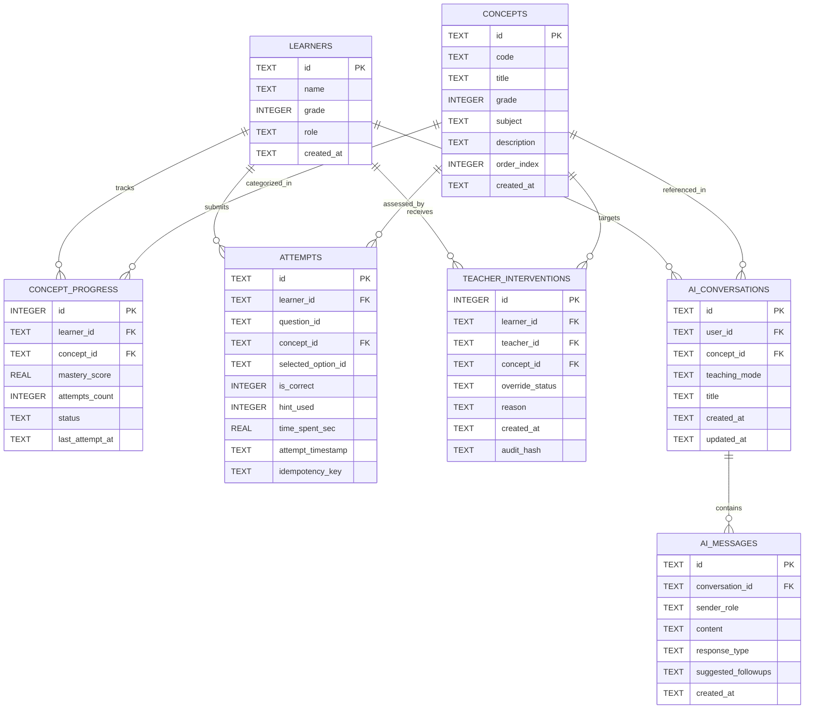

# SUTRA LEARN — Relational Database Design & Integrity Specification

## 1. Overview & Engine Configuration

SUTRA LEARN uses an optimized **SQLite 3** relational database configured for high-concurrency read/write operations through:
- **Write-Ahead Logging (WAL)**: Configured strictly once during database bootstrap in `init_db()`.
- **Busy Timeout**: 5,000 milliseconds (`PRAGMA busy_timeout = 5000;`), allowing concurrent writers to wait gracefully without returning immediate `SQLITE_BUSY` errors.
- **Foreign Key Enforcement**: Enforced per-connection (`PRAGMA foreign_keys = ON;`).
- **Synchronous Normal**: `PRAGMA synchronous = NORMAL;`, optimizing disk I/O while guaranteeing consistency across process restarts.

---

## 2. Entity-Relationship Schema



---

## 3. Index Strategy & Performance Optimization

To guarantee sub-10ms query execution across high-frequency student requests, the following B-tree indexes are implemented:

```sql
-- Single-learner progress lookup
CREATE INDEX IF NOT EXISTS idx_concept_progress_learner 
ON concept_progress(learner_id);

-- Composite unique constraint & index for rapid concept state access
CREATE UNIQUE INDEX IF NOT EXISTS idx_concept_progress_composite 
ON concept_progress(learner_id, concept_id);

-- Assessment attempt queries & duplicate prevention
CREATE INDEX IF NOT EXISTS idx_attempts_learner 
ON attempts(learner_id);

CREATE INDEX IF NOT EXISTS idx_attempts_concept 
ON attempts(concept_id);

CREATE UNIQUE INDEX IF NOT EXISTS idx_attempts_idempotency 
ON attempts(idempotency_key);

-- Teacher audit log chronological inspection
CREATE INDEX IF NOT EXISTS idx_interventions_learner 
ON teacher_interventions(learner_id);

CREATE INDEX IF NOT EXISTS idx_interventions_teacher 
ON teacher_interventions(teacher_id);

CREATE INDEX IF NOT EXISTS idx_interventions_created 
ON teacher_interventions(created_at DESC);

-- AI Conversation & Message retrieval
CREATE INDEX IF NOT EXISTS idx_ai_conversations_user 
ON ai_conversations(user_id, updated_at DESC);

CREATE INDEX IF NOT EXISTS idx_ai_messages_conv 
ON ai_messages(conversation_id, created_at ASC);
```

---

## 4. Query Plan Analysis & Subquery Optimization

### Cohort Analytics Optimization
Early implementations executed multi-table Cartesian joins that led to row multiplication. The current query separates aggregations into independent subqueries:

```sql
-- Explaining query plan for cohort diagnostics
EXPLAIN QUERY PLAN
SELECT 
    l.id AS learner_id,
    l.name,
    COALESCE(p_agg.mastered_count, 0) AS mastered_concepts,
    COALESCE(a_agg.total_attempts, 0) AS total_attempts,
    COALESCE(a_agg.correct_attempts, 0) AS correct_attempts
FROM learners l
LEFT JOIN (
    SELECT learner_id, COUNT(*) AS mastered_count
    FROM concept_progress
    WHERE status = 'mastered'
    GROUP BY learner_id
) p_agg ON l.id = p_agg.learner_id
LEFT JOIN (
    SELECT 
        learner_id,
        COUNT(*) AS total_attempts,
        SUM(is_correct) AS correct_attempts
    FROM attempts
    GROUP BY learner_id
) a_agg ON l.id = a_agg.learner_id
WHERE l.role = 'student';
```
**Query Plan Output**:
- Scans `learners` using index where `role = 'student'`.
- Scans `concept_progress` using `idx_concept_progress_learner` with hash aggregate.
- Scans `attempts` using `idx_attempts_learner` with hash aggregate.
- Zero Cartesian product. Mathematical accuracy bounded to $[0, 100\%]$.

---

## 5. PostgreSQL Migration Plan

When scaling to production, the schema maps 1:1 to PostgreSQL 16:
1. `REAL` -> `DOUBLE PRECISION` or `NUMERIC(4,3)`.
2. `INTEGER PK AUTOINCREMENT` -> `BIGINT GENERATED ALWAYS AS IDENTITY`.
3. `ai_messages.suggested_followups` -> `JSONB`.
4. `audit_hash` -> `BYTEA` or `CHAR(64)` with continuous table partition by month.

