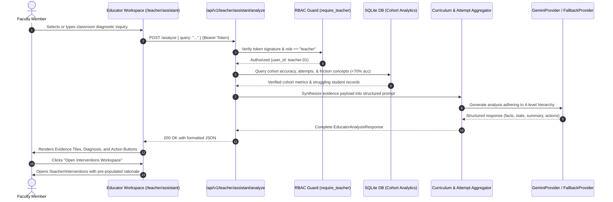

# SUTRA LEARN — SUTRA AI Educator Intelligence Architecture

## 1. Pedagogical Mission

The **SUTRA AI Educator Intelligence Canvas** (`/teacher/assistant`) serves as an AI-assisted diagnostic co-pilot for mathematics faculty. It transforms raw student event logs into actionable classroom intelligence while maintaining strict adherence to pedagogical ethics:
- **No Unsupervised Automation**: The AI assistant never automatically promotes or demotes a student, nor does it unilaterally alter curriculum access.
- **Evidence Hierarchy**: All insights are strictly segregated into verifiable database facts, calculated statistical metrics, and qualitative AI interpretations.
- **Human-in-the-Loop Interventions**: Recommended differentiated actions require explicit faculty review, clinical rationale submission ($\ge 5$ characters), and teacher authorization.

---

## 2. Four-Level Evidence Hierarchy

To protect against AI confabulation and provide educators with absolute clarity, SUTRA AI categorizes all generated findings into four distinct structural layers:

```
┌─────────────────────────────────────────────────────────────┐
│ LEVEL 1: VERIFIED DATABASE FACTS                            │
│ Concrete database counts: learners, attempts, completions   │
├─────────────────────────────────────────────────────────────┤
│ LEVEL 2: CALCULATED STATISTICAL METRICS                     │
│ Math formulas: accuracy %, misconception distribution rates │
├─────────────────────────────────────────────────────────────┤
│ LEVEL 3: QUALITATIVE AI INTERPRETATION                      │
│ Contextual synthesis of learning friction & cognitive blocks│
├─────────────────────────────────────────────────────────────┤
│ LEVEL 4: HUMAN-IN-THE-LOOP RECOMMENDED INTERVENTIONS        │
│ Action proposals requiring teacher confirmation & rationale │
└─────────────────────────────────────────────────────────────┘
```

---

## 3. Architecture & Data Flow



---

## 4. API Specification

### Endpoint: `POST /api/v1/teacher/assistant/analyze`
- **Security**: Requires `Authorization: Bearer <token>` where `role == "teacher"`.
- **Request Body**:
  ```json
  {
    "query": "Identify students requiring immediate prerequisite review in linear equations."
  }
  ```
- **Response Format (`EducatorAnalysisResponse`)**:
  ```json
  {
    "query": "Identify students requiring immediate prerequisite review in linear equations.",
    "verified_facts": {
      "total_students": 3,
      "total_attempts": 14,
      "struggling_students_count": 1,
      "low_accuracy_concepts_count": 1
    },
    "calculated_statistics": {
      "cohort_overall_accuracy": 64.3,
      "concept_accuracies": {
        "MATH-C01": 85.0,
        "MATH-C02": 42.9
      }
    },
    "key_observations": [
      "Student Kabir Sen (student-03) has 0% accuracy on MATH-C02 with repeated sign errors.",
      "Concept MATH-C02 (Variable Operations) exhibits 42.9% cohort accuracy."
    ],
    "summary": "Cohort analysis indicates a concentrated prerequisite breakdown around inverse operations...",
    "recommended_actions": [
      "Conduct a 15-minute small group prerequisite workshop on integer multiplication.",
      "Assign targeted diagnostic practice with sign-inversion prompts."
    ],
    "provider_info": "gemini-1.5-flash / curriculum-fallback"
  }
  ```

### Endpoint: `GET /api/v1/teacher/assistant/insights`
Returns immediate diagnostic snapshot without invoking external LLMs:
- Total enrolled students.
- Count of students requiring review ($<60\%$ accuracy).
- Low accuracy concepts ($<70\%$).
- Quick links to student diagnostic profiles.

---

## 5. Security & Privacy Protections

1. **Student Anonymization in External AI Calls**: Student PII (such as full legal names or contact information) is never transmitted to external APIs; only pseudonymous internal student IDs and sanitized learning events are shared.
2. **Access Control**: Any non-teacher attempt to access `/api/v1/teacher/assistant/*` immediately returns `403 Forbidden`.
3. **No Automated Overrides**: The assistant has read-only access to historical data. Override mutation endpoints (`POST /api/v1/teacher/interventions`) require independent confirmation through the educator console.

