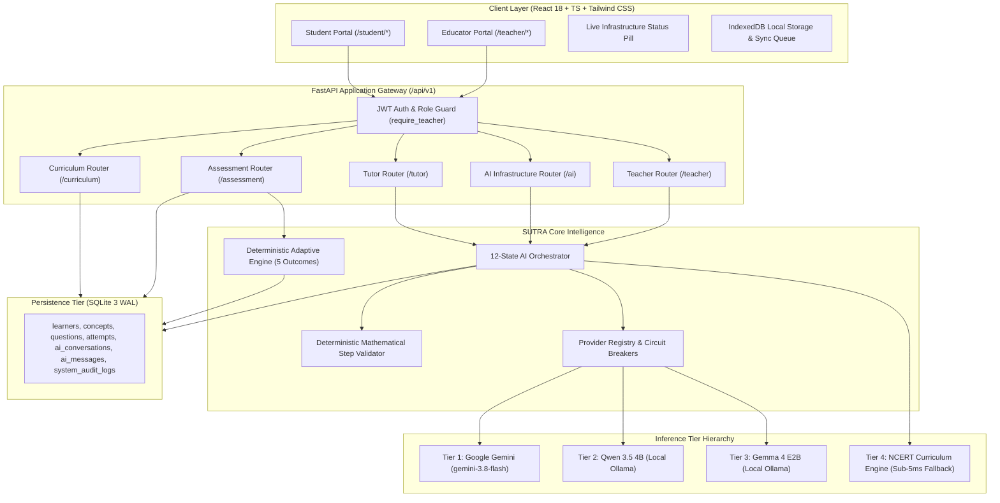

# SUTRA LEARN PHOENIX 10,000
## DOCUMENT 02: SYSTEM ARCHITECTURE & COMPONENT TOPOLOGY
**Version:** 1.0.0  
**Domain 1 (500 pts) & Domain 2 (650 pts):** Architecture & Backend Engineering  

---

### 1. Dual-Portal Architecture

SUTRA LEARN serves two distinct user personas through dedicated, responsive interfaces backed by a single authoritative FastAPI application gateway:

---

### 2. Tiered Inference Hierarchy & SLA Specifications

| Tier | Engine / Provider | Model Identifier | Runtime Location | Target Latency | Error Handling & Circuit Breaker |
| :--- | :--- | :--- | :--- | :--- | :--- |
| **Tier 1** | Google Gemini API | `gemini-3.8-flash` | Cloud (Google Generative AI REST) | $< 3,000$ ms | 403 `PERMISSION_DENIED` or 404 `MODEL_NOT_FOUND` trips circuit to `OPEN` immediately. 429 quota increments failure count. |
| **Tier 2** | Qwen 3.5 4B | `qwen3.5:4b` | Local Ollama (`127.0.0.1:11434`) | $< 45,000$ ms (CPU) / $< 3,000$ ms (GPU) | Local socket health probe. Strips `<think>` stream. Bounded timeout prevents UI hangs. |
| **Tier 3** | Gemma 4 E2B | `gemma4:e2b` | Local Ollama (`127.0.0.1:11434`) | $< 12,000$ ms (CPU) / $< 1,500$ ms (GPU) | Direct concise instruction-following model. High-speed local fallback. |
| **Tier 4** | NCERT Curriculum Engine | `ncert-class8-curriculum-v1` | In-Process Memory | $< 5$ ms | Guaranteed 100% deterministic availability. Complete syllabus coverage (`MATH-C01` to `MATH-C06`). |

---

### 3. Separation of Concerns & Subsystem Boundaries

1. **Deterministic Adaptive Engine (`backend/app/engine/`):** Solely responsible for assessing learner attempts, calculating confidence scores, and assigning pedagogical pathways (`BRIDGE_BACK`, `SCAFFOLD`, `STRETCH`, `CONFIRM`, `TEACHER_REVIEW`). Never uses LLM non-determinism for grading.
2. **AI Orchestration (`backend/app/ai/`):** Handles open-ended student Socratic dialogue and teacher classroom diagnostics with strict mathematical output validation.
3. **Database Layer (`backend/app/db/`):** Manages atomic database connections, WAL mode concurrency, relational integrity, and audit logging.

