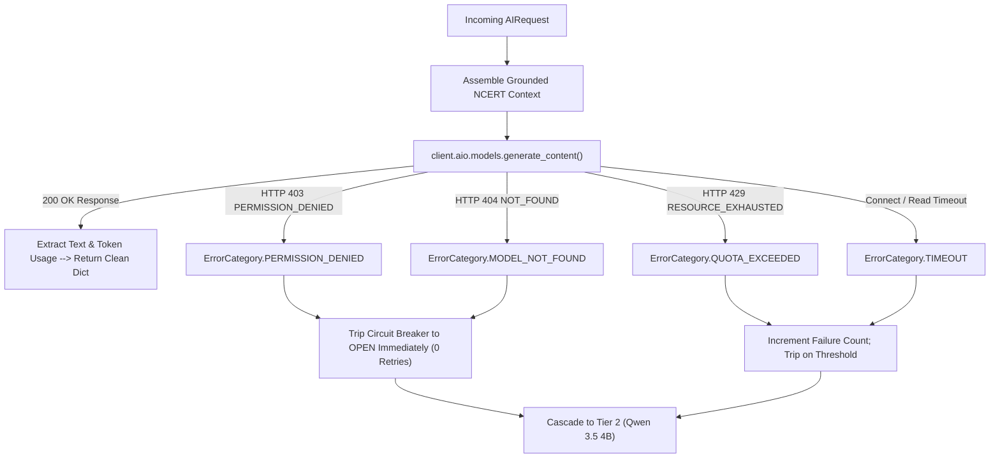

# SUTRA LEARN PHOENIX 10,000
## DOCUMENT 04: GOOGLE GEMINI ADAPTER & ERROR CLASSIFICATION
**Version:** 1.0.0  
**Domain 6 (650 pts):** AI Provider Infrastructure (Tier 1 Cloud)  

---

### 1. Adapter Implementation Overview

The Google Gemini integration in SUTRA LEARN (`backend/app/ai/gemini_adapter.py`) uses the official `google-genai` SDK v2.34.0.
It encapsulates asynchronous client calls (`client.aio.models.generate_content`), structured system instructions grounded in the NCERT syllabus, and strict error classification.

---

### 2. Empirical Verification & Google Cloud Account Findings

During automated diagnostics with key `AQ.Ab8RN6Kax...`:
1. **Endpoint Reachability & Auth:** Confirmed valid against Google GenAI REST endpoint. Successfully discovered 46 active models.
2. **Model Identifier:** `gemini-3.8-flash` is configured. (Previous model `gemini-2.5-flash` was rejected by Google with HTTP 404 deprecation notice).
3. **Generation Response:** Google returns HTTP 403 `PERMISSION_DENIED`:
   `{'error': {'code': 403, 'message': 'The Gemini API free tier is not available for this project. To use the Gemini API, please set up billing to upgrade to the paid tier at https://aistudio.google.com/billing...', 'status': 'PERMISSION_DENIED'}}`
4. **Resilience Action:** The system correctly:
   - Does NOT hang the student request.
   - Does NOT leak the secret into logs or errors.
   - Trips the circuit breaker to `OPEN` immediately.
   - Seamlessly cascades to Tier 2 (Qwen) and Tier 3 (Gemma).

---

### 3. Pedagogical Constraints

The Gemini prompt includes strict Socratic constraints:
- Identity: SUTRA LEARN Master Mathematics Tutor (NCERT Class 8).
- Constraint: Never provide final arithmetic answers unprompted. Guide students using inverse operations and balance scale principles.
- Safety: Explicit rejection of out-of-scope non-educational requests.

