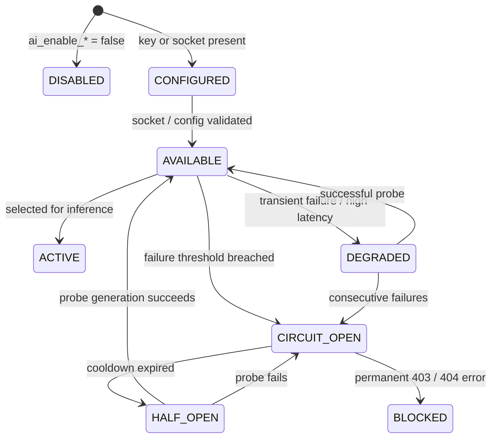

# SUTRA LEARN PHOENIX 10,000
## DOCUMENT 07: PROVIDER REGISTRY & LIFECYCLE MANAGEMENT
**Version:** 1.0.0  
**Domain 6 (650 pts) & Domain 7 (450 pts):** Provider Infrastructure & Orchestration  

---

### 1. Registry Architecture & Centralized Contract

The `AIProviderRegistry` (`backend/app/ai/registry.py`) is the single source of truth for AI provider metadata, health states, and circuit breaker associations.

---

### 2. Provider State Taxonomy

The registry enforces seven discrete provider states:

| State | Definition | Example Scenario |
| :--- | :--- | :--- |
| **`DISABLED`** | Administratively disabled via `.env` flag. | `AI_ENABLE_GEMINI=false`. |
| **`CONFIGURED`** | Environment credentials or socket URL defined, pending health probe. | Daemon starting up. |
| **`AVAILABLE`** | Validated and ready to accept inference requests. | Ollama responsive, model cached. |
| **`ACTIVE`** | Currently executing an inference task. | In-flight request. |
| **`DEGRADED`** | Experiencing high latency or sporadic timeouts. | High CPU load on host. |
| **`BLOCKED`** | Permanent error prevents generation. | Google Cloud free tier project billing restriction (HTTP 403). |
| **`UNAVAILABLE`** | Service daemon offline or model tag not found. | Ollama daemon stopped. |

---

### 3. Non-Invasive Diagnostics Protocol

`evaluate_provider_health()` executes fast, safe diagnostic probes:
- **Cloud (Gemini):** Verifies key presence and model tag formatting without dispatching billed inference tokens.
- **Local (Ollama):** Socket probe on port `11434` with 2.0s connect timeout, followed by tag verification via `/api/tags`.
- **Deterministic Fallback:** Zero-latency memory check against the NCERT curriculum knowledge graph.

