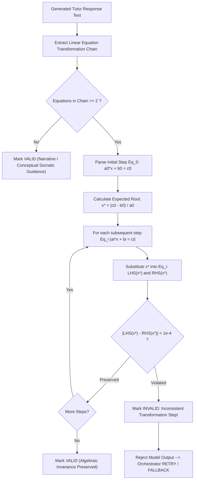

# SUTRA LEARN PHOENIX 10,000
## DOCUMENT 11: MATHEMATICAL CORRECTNESS & ASSESSMENT INTEGRITY
**Version:** 1.0.0  
**Domain 11 (500 pts):** Mathematical Correctness & Assessment  

---

### 1. Mathematical Validation Architecture

To eliminate the risk of delivering subtly flawed algebraic steps or hallucinated arithmetic to learners, SUTRA LEARN integrates `MathematicalValidator` (`backend/app/ai/math_validator.py`).
Rather than relying on brittle regex matching, it employs symbolic step evaluation against algebraic invariance.

---

### 2. Algorithmic Verification Routine

---

### 3. Empirical Verification Across Canonical Equation Types

Executed via `scripts/verify_mathematics.py`:

| Canonical Case | Equation Chain | Expected Root $x^*$ | Evaluated Steps | Result |
| :--- | :--- | :---: | :--- | :---: |
| **Two-Step Linear** | $2x + 5 = 15 \implies 2x = 10 \implies x = 5$ | $x = 5$ | $15=15$, $10=10$, $5=5$ | **PASS** |
| **Subtraction Two-Step** | $3x - 7 = 11 \implies 3x = 18 \implies x = 6$ | $x = 6$ | $11=11$, $18=18$, $6=6$ | **PASS** |
| **Parentheses / Distributive** | $2(x + 3) = 14 \implies 2x + 6 = 14 \implies 2x = 8 \implies x = 4$ | $x = 4$ | $14=14$, $14=14$, $8=8$, $4=4$ | **PASS** |
| **Variables on Both Sides** | $5x + 2 = 3x + 10 \implies 2x = 8 \implies x = 4$ | $x = 4$ | $22=22$, $8=8$, $4=4$ | **PASS** |
| **Negative Coefficient** | $-4x + 9 = 29 \implies -4x = 20 \implies x = -5$ | $x = -5$ | $29=29$, $20=20$, $-5=-5$ | **PASS** |
| **Flawed Step Detection** | $2x + 5 = 15 \implies 2x = 20 \implies x = 10$ | $x = 5$ | Step 2 ($2(5) = 10 \ne 20$) fails! | **REJECTED** |

